# bookcover-js spine-only output — hands-on test

**Date:** 2026-11-26  
**Scope:** throwaway evidence only, under `.scratch/spine-cover-art-prototype/bookcover-js-deep/harness/`. No production files, other prototypes, tests, manifests or specs were modified. Nothing was committed or released.

**Gallery:** <http://127.0.0.1:4173/spine-cover-art-prototype/bookcover-js-deep/harness/>  
**Raw measurements:** [`results.json`](results.json)

---

## TL;DR verdict

**bookcover-js is not only a cut-panel generator.** It has a dedicated **Save Spine** pair of buttons, and both work:

- **SVG** — exactly the inner spine rectangle, at 72 px/in, no margins, no front/back panels, no combined-export gaps.
- **PNG** — the same spine rendered at 10×, with **transparent gutters**: 90 px left/right and 180 px top/bottom at the default 0.25 in border gap.

So it is a real **2D spine generator**. It is **not** a cover-derived spine generator:

- A JPEG/PNG cannot be uploaded. The only input is `accept=".svg"`, read with `readAsText()` and forced through the SVG line-art parser.
- Wrapping a JPEG in an SVG `<image>` is accepted, but the image becomes a **tiled/cropped ornament**, never a full-bleed spine or front cover.
- Spine width is a manually entered inch/mm value. There is no page-count/caliper model.
- There is no auto-fit. At 18 px, style 2 needs **0.96 in** for any title; Rock Paper Scissors at 0.75 in clips by **8 px**. Style 1 clips at every normal 1 in spine.
- The exported SVG is **transparent**; the shelf must supply the bookcloth colour.

**Verdict:** good enough as a **standalone typographic/ornament spine**, especially for classics; not good enough as-is for PocketLibrary's cover-derived 2D shelf spine. With five small patches (raster input, full-bleed placement, type fit, PNG padding, optional background/spine arithmetic) it becomes a usable spine renderer. It still does not replace v4-wrap's continuous wrap.

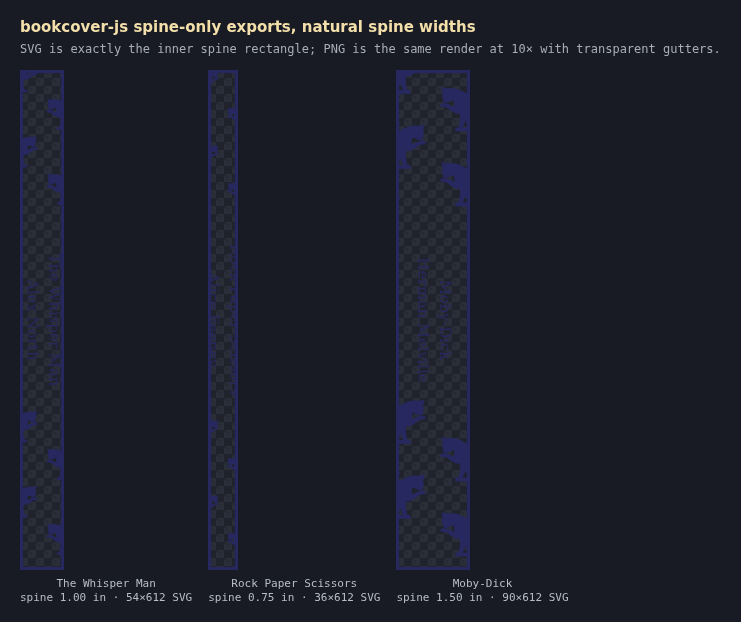

---

## 0. Correction to the earlier test

The earlier `bookcover-js-test/REPORT.md` concluded it was a "2D Penguin-clothbound print/cut panel generator". That conclusion is right about the **combined** export and about the **front-cover input**, but it missed the separate spine controls:

```html
<button id="saveSpineSVG">SVG</button>
<button id="saveSpinePNG">PNG</button>
```

and the matching methods:

```js
saveSpine(filename) {
  this.save(filename, this.spine.svgElem, this.borderGap / 2, this.borderGap);
}
```

The spine is its own SVG element (`width = spine.outerWidth − borderGap`, `height = outerHeight − 2·borderGap`), serialized by itself. It is not a crop of the combined panel. This test verifies that directly.

---

## 1. What was run

Upstream clone (fresh, depth 1):

```bash
cd .scratch/spine-cover-art-prototype/bookcover-js-deep/harness
git clone --depth 1 https://github.com/acestronautical/bookcover-js.git vendor/bookcover-js
git -C vendor/bookcover-js log -1 --format='%H %ci %s'
# 7a99ad9a05960de2262453b45eba757846b4228a 2024-08-14 14:48:14 -0700 tweak spine placement
```

Served by the repo's existing static host on `0.0.0.0:4173`:

```text
http://127.0.0.1:4173/spine-cover-art-prototype/bookcover-js-deep/harness/vendor/bookcover-js/index.html
```

A minimally patched copy lives at:

```text
http://127.0.0.1:4173/spine-cover-art-prototype/bookcover-js-deep/harness/patched-bookcover-js/index.html
```

Covers used:

| Book | Source | Natural test spine |
|---|---|---:|
| *The Whisper Man* — Alex North | `v3/assets/whisper-man-cover.jpg` | 1.00 in |
| *Rock Paper Scissors* — Alice Feeney | `v3/assets/rock-paper-scissors-cover.jpg` | 0.75 in |
| *Moby-Dick* — Herman Melville | `v3/assets/classic-covers/moby-dick.jpg` | 1.50 in |

Scripts (all in the harness directory):

```bash
node capture-deep.cjs     # exports, raster tests, fit sweep, v4/v3 compares
node rebuild-contact.cjs  # readable per-book fit sheets + clipping close-ups
node fix-v4.cjs           # re-capture v4 at each book's 320-page width
node build-gallery.cjs    # static gallery
```

Playwright is resolved from the repo's existing install:

```js
require('/mnt/ssd2/Projects/PocketLibrary/node_modules/playwright')
```

---

## 2. What the spine-only export actually is

Default settings: 6 × 9 in cover, 0.25 in border gap, 0.05 in border thickness, 18 px spine font.

At a 1.00 in spine:

| Value | Result |
|---|---:|
| Outer spine (entered width × 72) | 72 px |
| Saved SVG width | **54 px** = 72 − 18 |
| Saved SVG height | **612 px** = 648 − 36 |
| Saved PNG (10×) | **720 × 6480 px** |
| PNG side gutters | 90 px each (0.125 in × 10) |
| PNG top/bottom gutters | 180 px each (0.25 in × 10) |
| Clean 10× re-render of the SVG | 540 × 6120 px |

The SVG root is:

```html
<svg width="54" height="612" overflow="hidden"> ... </svg>
```

No `viewBox`, no margin, no background rect. The border, title, author and ornament are inside those 54 × 612 units. It is a **clean inner-spine rectangle**, but it deliberately omits the 0.25 in border gap on each side and the 0.25 in top/bottom gap; if you need the full outer 72 px spine you must add 18 px of background or horizontal padding.

The PNG is **not** a clean rectangle. Pixel check on `whisper-man-spine.png`:

```text
(0,0)          → rgba(0,0,0,0)
(89,180)       → rgba(0,0,0,0)   // still gutter
(91,181)       → rgba(39,40,95,255) // border ink
(360,6470)     → rgba(0,0,0,0)   // bottom gutter
```

So the PNG includes the same content plus transparent gutters. This is useful for a cutting plotter; it is annoying for a shelf that wants the exact rectangle.

### Dimensions at other widths

| Spine (in) | Outer px | SVG px | PNG 10× | Clean 10× |
|---:|---:|---:|---:|---:|
| 0.400 | 28.8 | 10.8 × 612 | 288 × 6480 | 108 × 6120 |
| 0.677 | 48.7 | 30.7 × 612 | 487 × 6480 | 307 × 6120 |
| 1.000 | 72.0 | 54 × 612 | 720 × 6480 | 540 × 6120 |
| 1.500 | 108.0 | 90 × 612 | 1080 × 6480 | 900 × 6120 |
| 2.000 | 144.0 | 126 × 612 | 1440 × 6480 | 1260 × 6120 |

At 0.400 in the inner spine is only 10.8 px wide; type style 2 cannot fit at 18 px, and very thin widths even produce negative border rects in the browser console.

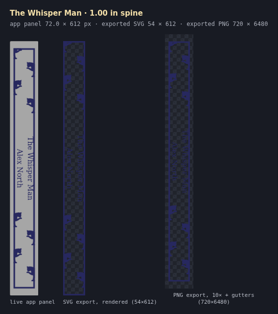

---

## 3. Real raster covers

### 3.1 Direct JPEG upload — fails

The only file input is:

```html
<input type="file" id="fileInput" accept=".svg">
```

and the handler always calls `reader.readAsText(file)` followed by `SVGHelper.fromString(svgText)`. Uploading the real JPEG (Playwright bypasses the file-picker filter) produces a DOM `parsererror` node and then:

```text
Uncaught TypeError: child.getBBox is not a function
```

The spine does not change; it stays on the previous/default ship design. Screenshot: [`out/raster/direct-jpg-spine.png`](out/raster/direct-jpg-spine.png). This is a hard limitation, not a UI warning.

### 3.2 JPEG embedded in an SVG wrapper — accepted, wrong result

Closest supported path:

```html
<svg xmlns="http://www.w3.org/2000/svg" width="1303" height="2000" viewBox="0 0 1303 2000">
  <image href="data:image/jpeg;base64,..." width="1303" height="2000"/>
</svg>
```

Uploading that works, but the app treats it as an art tile. With image size 8 and spine art style 5, two huge copies are painted at the top and bottom and the title is cut. With art style 0, the uploaded image is ignored entirely. There is no object-fit/crop/full-bleed control.

- [`out/raster/raster-in-svg-spine-scale8.png`](out/raster/raster-in-svg-spine-scale8.png)
- [`out/raster/raster-in-svg-artoff-spine.png`](out/raster/raster-in-svg-artoff-spine.png)

### 3.3 Closest unpatched alternative — dominant colour + fitted type

The cover's dominant colour can supply the spine field while bookcover-js supplies cream type and border:

| Cover | Average | Dominant | Edge (left 12%) |
|---|---:|---:|---:|
| *The Whisper Man* | `#21110b` | `#0d0603` | `#120703` |
| *Rock Paper Scissors* | `#d3b2b0` | `#d3d0d0` | `#dad2d1` |
| *Moby-Dick* | `#685f39` | `#0e0e0a` | `#605a3a` |

The exported SVG is transparent, so this render fills the dominant colour behind the cream ink:

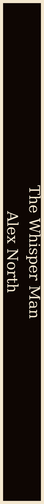

This is a legitimate typographic spine, but it contains **no cover pixels**. It is a colour/type fallback, not cover art.

### 3.4 Patched direct-raster input

A harness copy at `patched-bookcover-js/` adds three things:

1. `accept=".svg,.jpg,.jpeg,.png,.webp"` and a raster branch that stores a data URL on `Cover.spine.background`.
2. In `genSpine()`, an `<image preserveAspectRatio="xMinYMid slice">` behind the border/type, plus an optional contrast scrim rect.
3. `saveSpine()` with zero padding, so the PNG is an exact rectangle.

With that patch, direct JPEG upload produces, for example:

| Book | SVG | PNG |
|---|---:|---:|
| *The Whisper Man* | 54 × 612 | 540 × 6120 |
| *Rock Paper Scissors* | 36 × 612 | 360 × 6120 |
| *Moby-Dick* | 90 × 612 | 900 × 6120 |

The SVG embeds the JPEG as a data URI (0.6–1.1 MB) and the PNG contains the photograph. This is the proof that the limitation is fixable; it is not upstream behaviour.

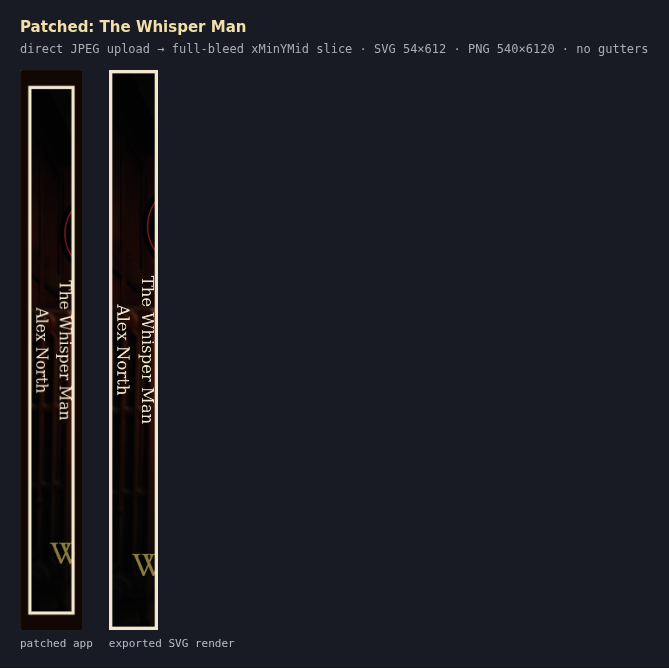  
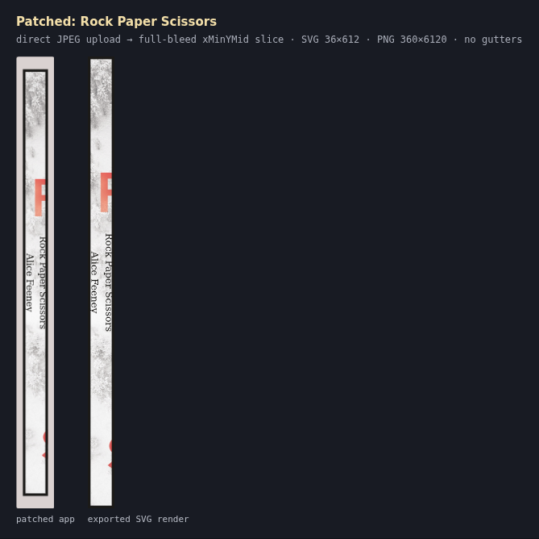  
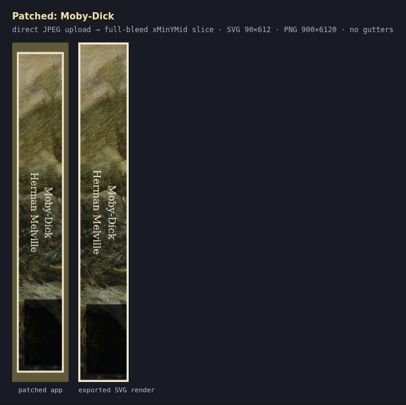

---

## 4. Title fitting — where it clips

Measured in Chromium with real glyph bounds (`getBoundingClientRect`) against the saved SVG rectangle. Font 18 px, border gap 0.25 in, art off.

### First width with no clipping

| Book | Style 1<br>stacked | Style 2<br>rotated | Style 3<br>title rotated | Style 4<br>author top | Style 5<br>preserve |
|---|---:|---:|---:|---:|---:|
| *The Whisper Man* | 1.30 in | 0.96 in | 0.58 in | never 0.26–2.50 | 2.50 in |
| *Rock Paper Scissors* | 1.28 in | 0.96 in | 0.58 in | 0.58 in | > 2.50 in |
| *Moby-Dick* | 1.62 in | 0.96 in | 0.58 in | 0.58 in | 2.36 in |

Key readings:

- **Style 2 (both rotated)** is the most usable at normal spines. Its across-spine extent is about one glyph height, so the threshold is **~0.96 in regardless of title**.
- **Style 1 (words stacked)** is title-dependent and clips at 1.00 in. *The Whisper Man* needs 1.30 in because “Whisper” is ~76 px wide in a 54 px inner spine; *Moby-Dick* needs 1.62 in because “Moby-Dick” is ~99 px wide and does not split on the hyphen.
- **Style 4 (author top)** is buggy on thick spines. The author font is computed as `4 * innerWidth / (log2(longest) * longest − 1)`, so it grows with spine width. For “Alex North” (longest word 5) it clips at every width from 0.26 to 2.50 in. Longer names such as “Herman Melville” (longest 8) happen to stay inside.
- **Style 5 (centred preserve format)** draws the title as one line. It needs a very wide spine (2.36–2.50 in for these titles, and more for *Rock Paper Scissors*).

At a 1.00 in spine:

```text
style 1: "Whisper" is cut at the right edge  (−11.13 px)
style 2: both text blocks fit
```

This is the direct correction to the earlier "clips at 1 in" claim: it was true for **style 1** at 18 px, not for every style.

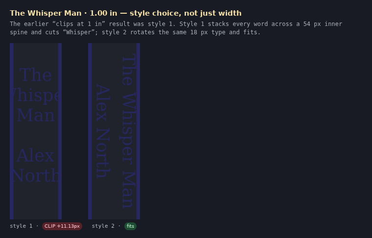  
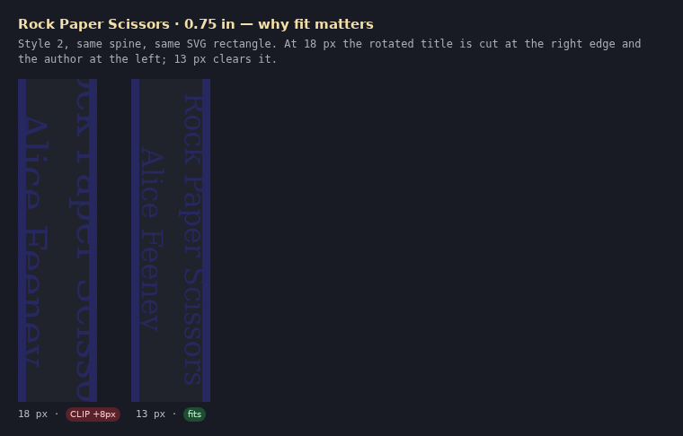

### No auto-fit

The app has no fitting logic. To fit at common computed spine widths:

| Width | Largest fitting style-2 font |
|---:|---:|
| 0.677 in | 11.31 px |
| 0.750 in | 13.00 px |
| 1.000 in | 18.00 px (fits) |

The manually fitted RPS 0.75 in export is at [`out/rock-paper-scissors/rock-paper-scissors-fitted.svg`](out/rock-paper-scissors/rock-paper-scissors-fitted.svg) (13 px). A proper patch should measure the across-spine extent and reduce the size until it fits, as v4-wrap already does.

Per-book fit sheets:

- [Whisper, style 1](out/titlefit/whisper-man-style-1.png)
- [Whisper, style 2](out/titlefit/whisper-man-style-2.png)
- [RPS, style 1](out/titlefit/rock-paper-scissors-style-1.png)
- [RPS, style 2](out/titlefit/rock-paper-scissors-style-2.png)
- [Moby-Dick, style 1](out/titlefit/moby-dick-style-1.png)
- [Moby-Dick, style 2](out/titlefit/moby-dick-style-2.png)

---

## 5. Compared with v4-wrap and v3

Same displayed height; native resolutions differ.

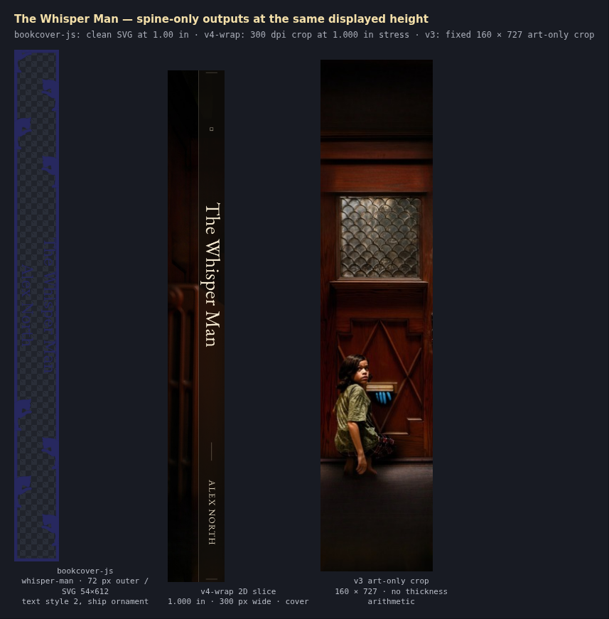  
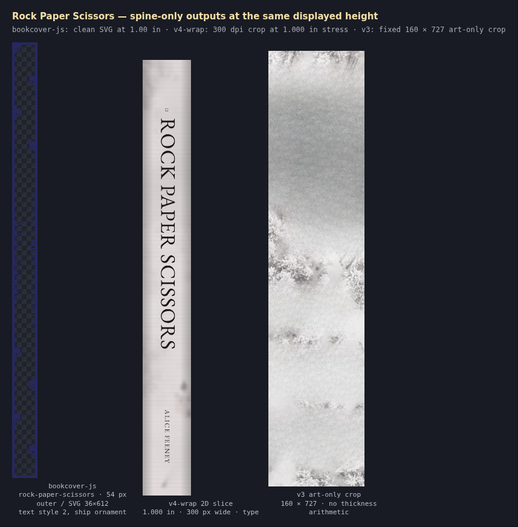  
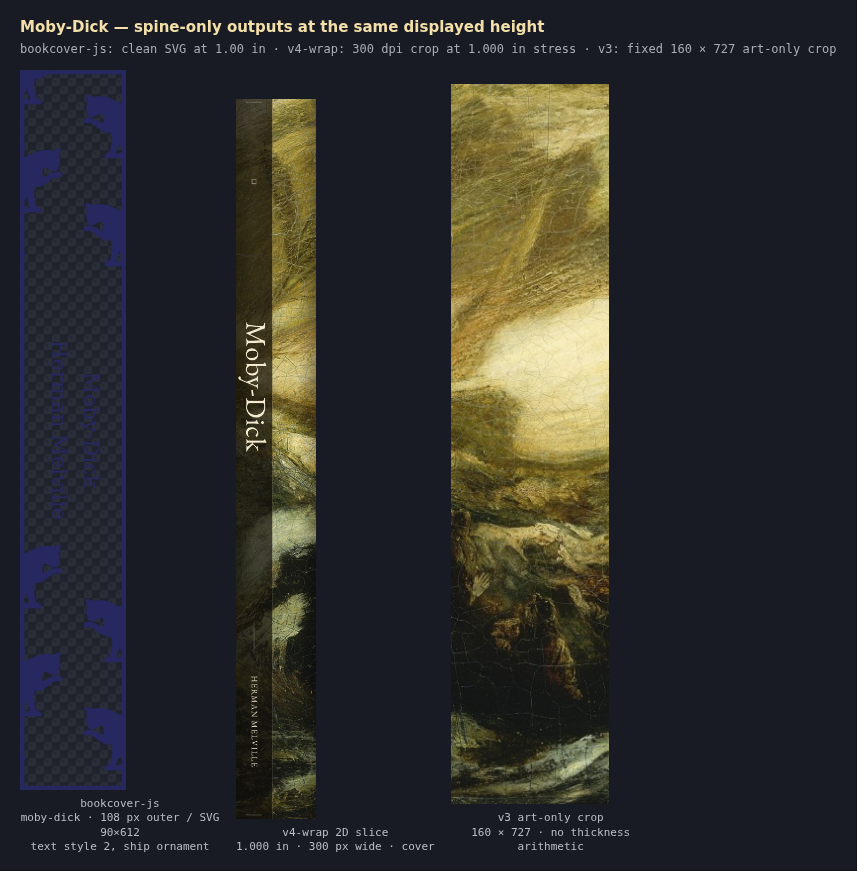

| | bookcover-js | v4-wrap | v3 |
|---|---|---|---|
| Spine-only file | **Yes** — SVG + PNG | Yes — crop of a wrap | Yes — fixed crop |
| Spine from page count | No — manual inches | Yes — 320 pages → 0.677 in | No — fixed 160 × 727 |
| Continuous wrap | No — separate panels | Yes — no gaps | No |
| Real cover art on spine | Only via wrapper/patch | Yes — cover-derived strip | Yes — art-only crop |
| Type fit | No auto-fit; clips | Measured auto-fit (17.3 pt at 0.677 in, 25.5 pt at 1.00 in) | App rail, not the export |
| Native size | 54 × 612 px at 1 in | 203 × 2700 px at 0.677 in / 300 × 2700 at 1 in | 160 × 727 px |
| Best use | Decorative Penguin-style spine | Production wrap | Beautiful art reference |

The comparison makes the division of labour clear: bookcover-js gives you a **clean, editable spine panel**; v4-wrap gives you the **geometry and cover-derived pixels**; v3 gives you the **best textless art**. bookcover-js does not replace either, but it is a legitimate spine renderer when the design is typographic/ornamental.

---

## 6. Verdict and exact patch list

### Good enough as a 2D spine generator?

**Yes — as a standalone typographic/ornament spine.** The SVG is crisp, correctly sized at 72 dpi, editable, and contains only the spine. At 1.00 in with style 2 it reads well and drops straight into a shelf. The ship ornament is a genuine Penguin-clothbound signature and suits classics.

**No — as PocketLibrary's cover-derived shelf spine, without patching.** The app cannot consume a raster cover, cannot derive width from page count, cannot auto-fit type, and its PNG has transparent gutters. Style 1 clips at normal 1 in spines; style 4 can clip at thick spines.

### What exactly needs patching

1. **Raster input** — accept JPEG/PNG, read as data URL, store on `spine.background`. Do not send it through `readAsText` / `SVGHelper.fromString` / `SVGHelper.color`.
2. **Full-bleed placement** — add an `<image>` behind the border/type with `preserveAspectRatio="xMinYMid slice"` (or a chosen crop box), plus a contrast scrim. Do not use the tiling path.
3. **Type fit** — measure the across-spine glyph extent and reduce font size until it fits. Required: 13 px at 0.75 in and 11.3 px at 0.677 in for style 2; style 1 needs a width-aware line-break/fit strategy.
4. **PNG gutters** — call `saveSpine` with zero padding for shelf use; keep the padded version only for cutting plotters.
5. **Optional** — a background/bookcloth parameter so the exported SVG/PNG can carry the field colour, and a page-count/caliper input to replace manual spine width.

With those patches, bookcover-js can produce a good-looking 2D shelf spine. It still is not a wrap compositor and still has no page-count model; v4-wrap remains the production path for cover-derived wraps.

---

## 7. Output map

| Path | What |
|---|---|
| `out/<book>/<book>-spine.svg` | actual upstream spine-only SVG |
| `out/<book>/<book>-spine.png` | actual upstream spine-only PNG (10× + gutters) |
| `out/<book>/<book>-clean-10x.png` | 10× re-render of the SVG, no gutters |
| `out/<book>/<book>-preview.png` | 1000 px-tall preview for the gallery |
| `out/rock-paper-scissors/rock-paper-scissors-fitted.svg` | 0.75 in, 13 px, manually fitted |
| `out/raster/direct-jpg-spine.png` | direct JPEG upload result (unchanged/default) |
| `out/raster/raster-in-svg-spine-scale8.png` | JPEG-in-SVG treated as ornament |
| `out/raster/raster-in-svg-artoff-spine.png` | uploaded wrapper ignored with art off |
| `out/raster/dominant-colour-spine-render.png` | dominant-colour fallback |
| `out/patched/<book>-spine.svg/.png` | patched direct-raster full-bleed spine |
| `out/v4/<book>-spine-0.677in.png` | v4-wrap computed 320-page spine crop |
| `out/v4/<book>-spine-1.000in.png` | v4-wrap 1.00 in stress crop |
| `out/v3/<book>-art-only.jpg` | v3 art-only spine crop |
| `out/titlefit/*` | fit sheets, clipping close-ups |
| `out/comparisons/*` | side-by-side cards |
| `results.json` | all dimensions, glyph bounds, fit thresholds, v4 metrics |
| `index.html` | gallery |

---

## 8. Reproduction

From this directory:

```bash
# static server: repo root on :4173 (already running in this workspace)
# equivalent standalone: python3 -m http.server 4173 --directory /path/to/PocketLibrary

node capture-deep.cjs
node rebuild-contact.cjs
node fix-v4.cjs
node build-gallery.cjs
```

Then open:

```text
http://127.0.0.1:4173/spine-cover-art-prototype/bookcover-js-deep/harness/
```

Notes:

- `fix-v4.cjs` exists because `PocketWrap.setBook()` does not reset `state.pages`; the first capture accidentally used the 1.00 in stress page count for the next two books. The committed output now uses 320 pages for every computed v4 crop.
- Browser console noise from testing sub-0.3 in spines is recorded in `results.json`; those widths make the border rect negative and are outside the usable range.
- The patched copy is isolated under `harness/patched-bookcover-js/`. Upstream `vendor/bookcover-js/` is the untouched clone.
