# bookcover-js spine generation test

**Date:** 2026-11-26  
**Scope:** isolated test only, under `.scratch/spine-cover-art-prototype/bookcover-js-test/`. No production code, v1/v2/v3 prototypes, tests, manifests or specs were modified. Nothing was committed or released.

**Verdict:** **bookcover-js is not usable for PocketLibrary's spine treatment.** It is a 2D Penguin-clothbound *print/cut panel* generator, not a cover-derived spine generator and not a 3D mockup. Its spine is a separate decorative strip with manually entered width; it cannot consume the real front cover, cannot derive thickness from page count, clips text at normal spine widths, and its “combined” export is not a continuous print wrap. The tested 3D alternatives also do not generate a spine from the cover: one is a 3D front-cover CSS mock with no spine face, the other has page-count thickness but a plain coloured spine box.

---

## 0. Worked vs failed (short version)

| Requirement | bookcover-js result |
|---|---|
| Load/run the real app | **Worked**; live site and local copy both run |
| Generate front/spine/back text panels | **Worked**; 5 spine text presets, 12 spine art presets |
| Use the real front cover | **Failed**; only single-colour SVG line art is accepted, and it is tiled as an ornament |
| Generate a spine from the cover | **Failed**; spine is an independent decorative/text panel |
| Page count → spine thickness | **Failed**; spine width is a manual inch/mm value |
| Spine text fits at normal width | **Failed**; clips at a valid 1 in spine with default 18 px font |
| Continuous front/spine/back wrap | **Failed**; 0.625 in gaps, missing outer margins, wrong spine zone |
| 3D book preview | **Failed**; no canvas/WebGL, flat SVG panels only |
| Print-ready export | **Failed**; combined output is for cutting/plotting, not CMYK/bleed print |
| Maintained/library-quality | **Failed**; last commit Aug 2024, no npm package/tests/API |

---

## 1. What bookcover-js is

| Item | Finding |
|---|---|
| Live site | <https://acestronautical.github.io/bookcover-js/> (loads; same behaviour as local source) |
| Repo | <https://github.com/acestronautical/bookcover-js> |
| Description | “An in browser tool for generating penguin clothbound classics style book cover SVG images” |
| Source | 3 JS files, 1,133 lines: `main.js` (355), `penguinstyle.js` (579), `svghelper.js` (199), plus a 262-line `index.html` (1,395 lines total) |
| Dependencies | None; ES modules loaded directly by the browser |
| Distribution | Static site only; no npm package, no releases, no library entry point |
| API | `PenguinCover` class exported from `penguinstyle.js`; methods `generateCovers()`, `genFront()`, `genBack()`, `genSpine()`, `saveCombined()`. The class is hard-wired to DOM IDs `#front-cover`, `#spine-cover`, `#back-cover`, `#front-cover` etc.; it is not a headless/reusable API. |
| Maintenance | Last push **2024-08-14**; 30 stars, 4 forks, 6 open issues, 158 commits; not archived. Issue #17 (Feb 2025) is still open. |
| Licence | MPL-2.0 (file-level copyleft) |
| Tests | None in the repo |

The app is explicitly aimed at **Cricut/Silhouette cutting plotters** (README: save SVG/PNG, “manual cropping at inner border”, PNG is preferred for Cricut). It generates decorative line art and text for a front panel, a spine panel, and a back/endpaper panel. It has no 3D viewer.

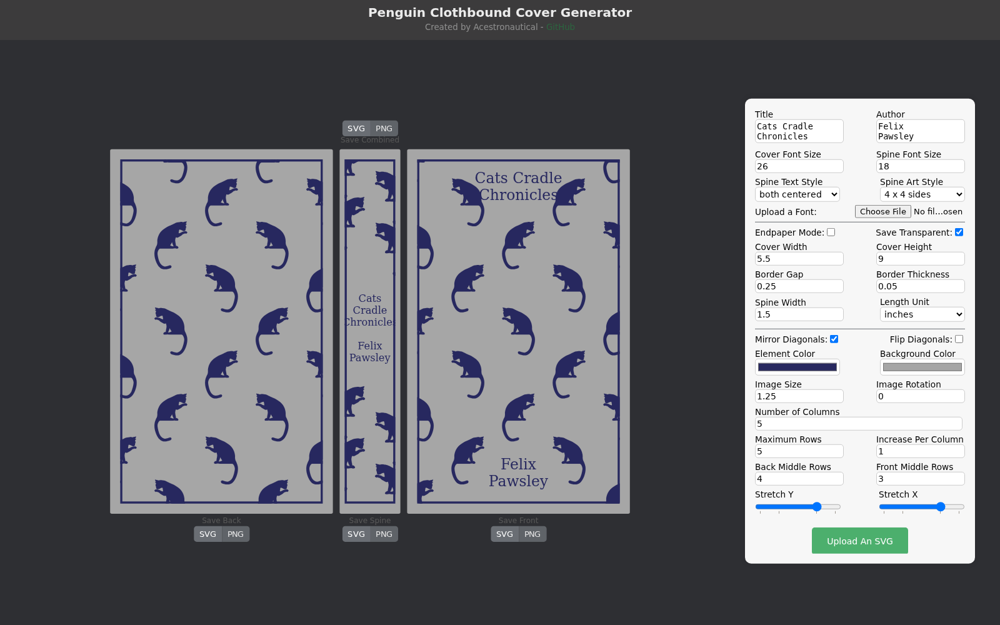

---

## 2. Harness and exact commands

### Local app copy

- Repo ZIP downloaded from `https://github.com/acestronautical/bookcover-js/archive/refs/heads/main.zip`
- Extracted to `bookcover-js-src/bookcover-js-main/`
- Served locally by the already-running static server:

```text
http://127.0.0.1:4173/spine-cover-art-prototype/bookcover-js-test/bookcover-js-src/bookcover-js-main/index.html
```

### Screenshot/test scripts

```bash
cd .scratch/spine-cover-art-prototype/bookcover-js-test

# Main matrix: real book metadata, 3 sample books, spine widths,
# raster-in-SVG upload, narrow-spine text test, combined exports.
node capture-bookcover.cjs

# UI/API inspection: controls, canvas count, panel sizes.
node inspect-bookcover.cjs

# Comparable A: reproduce scastiel's exact generated CSS with real covers.
node capture-3d-book-css.cjs

# Comparable B: Three.js book-3d harness.
cd comparables/book-3d-harness
npm install
npx vite --host 127.0.0.1 --port 4174
# In a second shell, from the test root:
cd ../..
node capture-book-3d.cjs
```

Environment: Node v24.21.0, Playwright 1.65.1 with Chromium. The scripts currently resolve Playwright through:

```js
require('/mnt/ssd2/Projects/PocketLibrary/node_modules/playwright')
```

The `book-3d` harness’s `node_modules/` was deleted after capture to keep the scratch directory small; `npm install` in `comparables/book-3d-harness/` restores it.

### Gallery

`index.html` is a visual index of the results:

```text
http://127.0.0.1:4173/spine-cover-art-prototype/bookcover-js-test/index.html
```

---

## 3. bookcover-js test results

### 3.1 It cannot use the real front cover

The only image input is:

```html
<input type="file" id="fileInput" accept=".svg">
```

The handler reads the file as **text**, parses it as SVG, and `SVGHelper.color()` forcibly sets every element’s `fill` and `stroke` to the single `elementColor` and removes inline styles. This is line-art input for a cutting plotter, not a cover-art pipeline. There is no JPEG/PNG input, no object-fit/crop control, and no way to say “this image is the front cover”.

To test what happens with a real cover, I embedded `whisper-man-cover.jpg` as a base64 `<image>` inside an SVG wrapper and uploaded it. The app treats it as a repeating ornament:

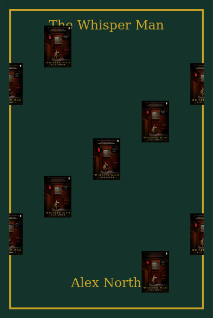


The actual cover becomes a tiny repeated motif, with a forced monochrome/line-art treatment elsewhere. It is never placed as the front cover, and the spine remains unrelated text/ornament. There is no crop/position control for a single cover image; the panel’s `overflow: hidden` merely chops each repeated motif at the panel edge.

**Result: fails the “spine from front cover” requirement.** The front, spine and back are designed independently from the cover image.

### 3.2 Spine generation: manual panel, no page count

The spine is a separate SVG panel generated by `genSpine()` from:

- title and author text,
- `Spine Text Style` (5 presets),
- `Spine Art Style` (12 presets),
- `Spine Font Size`,
- `Spine Width` entered directly in inches or millimetres.

There is **no page count, paper stock, PPI, or thickness calculator** in the UI or source. A search of the controls found `spineWidthInput` but no page/paper field; `Border Thickness` is the decorative border stroke (default 0.05 in), not book thickness. The only thickness control is the manual spine width.

Measured geometry at a 6 × 9 in trim and a 1 in spine:

| Item | Value |
|---|---|
| Front/back outer panel | 432 × 648 px (6 × 9 in at 72 dpi) |
| Spine outer panel | 72 × 648 px (1 × 9 in) |
| Front/back SVG inner area | 396 × 612 px (5.5 × 8.5 in after 0.25 in border gap) |
| Spine SVG inner area | **54 × 612 px** (0.75 × 8.5 in) |
| Canvas/WebGL | **0 canvases**; all panels are DOM/SVG |

The 0.25 in `borderGap` is removed from every panel’s artwork area, including the spine. So a nominal 1 in spine only gets 0.75 in of usable spine artwork.

Spine width series (same title/author, 18 px default spine font):

| Requested spine | Spine SVG inner width | Text lines outside panel | Result |
|---|---:|---:|---|
| 0.4 in (below UI min) | 10.8 px | 5 of 5 | Unusable; every word clipped |
| 0.8 in (below UI min) | 39.6 px | 4 of 5 | “Whisper”, “Man”, “Alex”, “North” clip |
| **1.0 in (valid UI value)** | **54 px** | **1 of 5** | “Whisper” is 76.3 px wide and clips; “North” is 54.4 px and touches the edge |
| 1.5 in | 90 px | 0 of 5 | Fits |

Screenshots:


At the valid 1 in width the spine visibly reads “The / Whispe / Man” and “Alex / North”: “Whisper” is clipped and “North” touches the edge. There is no auto-fit, no shrink-to-fit, and no warning. The user must manually lower `Spine Font Size` until it happens to fit.

### 3.3 Text behaviour

Five presets exist:

1. both centered (stacks every word on its own line)
2. both rotated
3. title rotated
4. author top
5. centered preserve format

The test used styles 1, 2 and 3. Style 1 stacks words and therefore produces very tall text at narrow widths; style 2/3 rotate the text but still use the fixed font size. None of the styles measure available width or scale text. Style 3 also intentionally omits the author.

The default font is a Garamond stack; on this Linux host it falls back to a system serif. Font upload is available but marked beta and only affects rendering if the font is also installed/embedded correctly.

### 3.4 “Combined” export is not a printable wrap

`saveCombined()` concatenates the three *inner* SVGs with a fixed gap:

```js
shoulderGap + borderGap * 1.5  // 18 + 27 = 45 px at 72 dpi
```

For the 6 × 9 in / 1 in spine test:

| Property | Combined SVG | Expected physical wrap |
|---|---:|---:|
| Overall size | **936 × 612 px** (13 × 8.5 in) | 936 × 648 px (13 × 9 in) |
| Back panel | x=0, width 396 | 432 wide (6 in) |
| Spine panel | x=441, width 54 | 72 wide (1 in) |
| Front panel | x=540, width 396 | 432 wide (6 in) |
| Gaps | 45 px either side of spine | no gap; continuous fold |
| Central spine zone | 54 + 45 + 45 = **144 px (2 in)** | 72 px (1 in) |
| Outer cloth margin | omitted (0.25 in per side) | included or bleed |

The total width happens to equal 13 in, but the distribution is wrong: front/back lose 0.25 in each, the spine zone grows to 2 in, and the outer 0.25 in margins are missing. Any artwork spanning the wrap will be misaligned. The combined PNG adds 0.25 in padding around the whole thing, producing 9720 × 6480 px at 10× (13.5 × 9 in), but the internal gaps and the missing continuous fold remain.

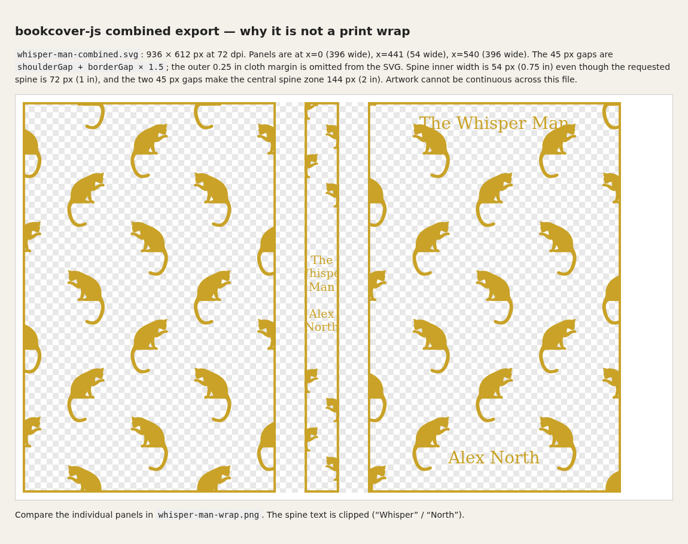

The app’s own tooltip says the SVG “will require manual cropping at inner border”. This is consistent with a cutting-plotter workflow, not a print-ready wraparound.

### 3.5 No 3D at all

`canvasCount = 0`, no WebGL scene, no perspective/rotate control. The UI shows three flat panels side by side. It is not a 3D front-cover mock; it is a 2D panel generator.

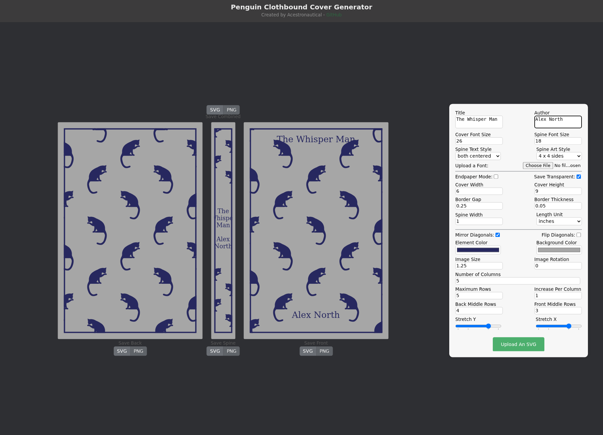

### 3.6 Sample-book runs

The harness used the real PocketLibrary cover set as metadata and as actual images where the tool could accept them:

| Sample | Metadata used | Spine | Text style | Result |
|---|---|---|---|---|
| The Whisper Man | Alex North | 1.0 in | both centered | Spine text clips; generic cat ornament front/back |
| Rock Paper Scissors | Alice Feeney | 0.75 in | both rotated | Rotated text fits vertically but is unrelated to the real cover; 36 px inner spine |
| Moby-Dick (classic) | Herman Melville | 1.5 in | title rotated | Fits; author omitted by style 3; generic cat ornament |

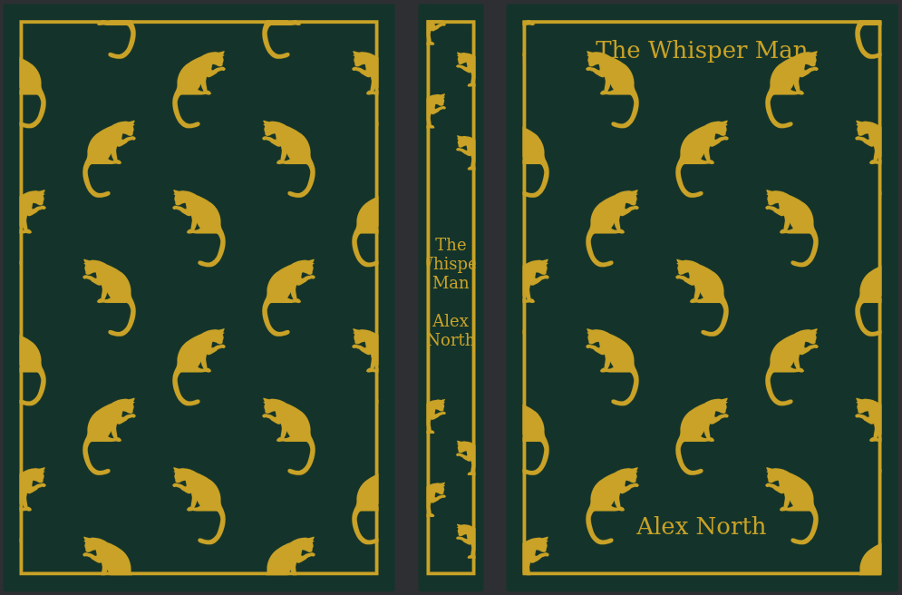
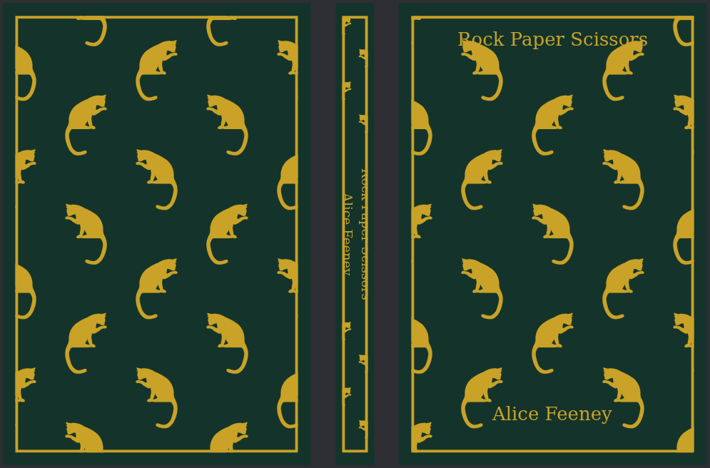
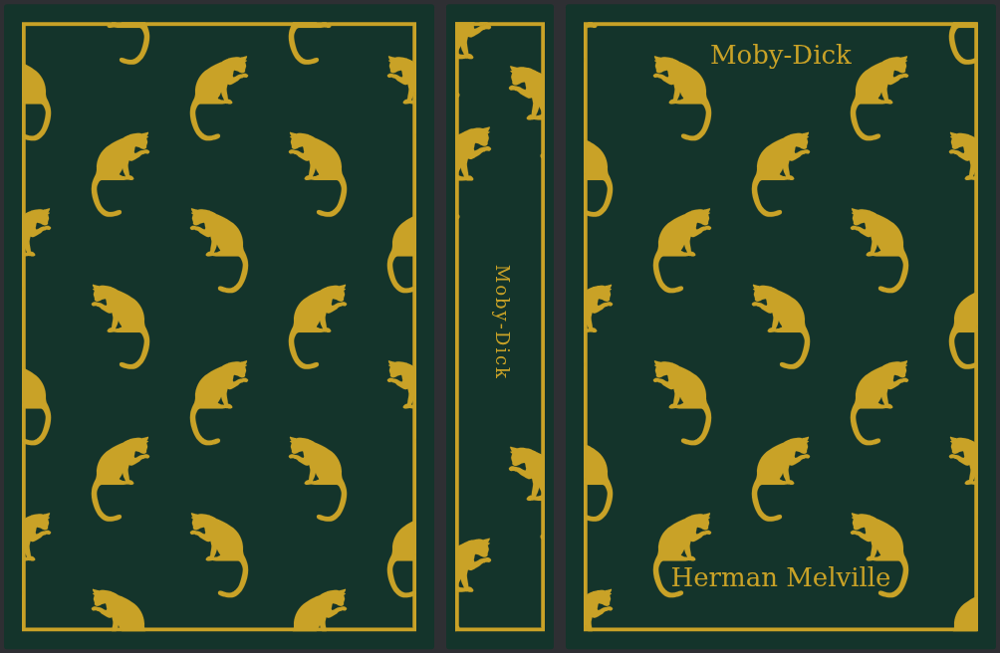

The real covers in `v3/assets/` were used directly in the comparable tests below. They could not be used in bookcover-js except as the tiled SVG-wrapper experiment above.

---

## 4. Comparable projects

### 4.1 3D Book Image CSS Generator (scastiel)

| Item | Finding |
|---|---|
| Repo | <https://github.com/scastiel/3d-book-image-css-generator> |
| Demo | <https://3d-book-css.netlify.app/> → redirects to <https://scastiel.dev/3dbook/> |
| Licence / traction | MIT; 658 stars, 70 forks; 4 open issues, 7 open PRs |
| Maintenance | Last push **2023-04-19**; dormant but usable |
| Input | Absolute URL of a front cover image; no upload |
| Output | HTML + CSS for a CSS-3D front cover |
| Controls | perspective, rotate, thickness (px), width, height, radius, pages offset, background colour |

I reproduced its exact generated CSS/markup locally, with the real covers, at `comparables/3d-book-css/book.html`. Screenshots:

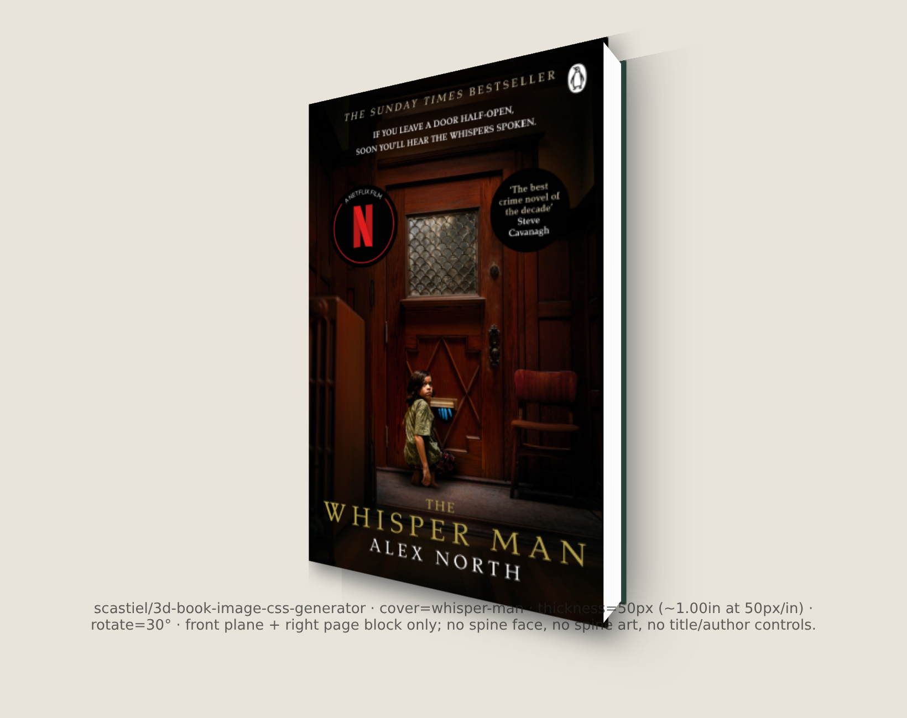
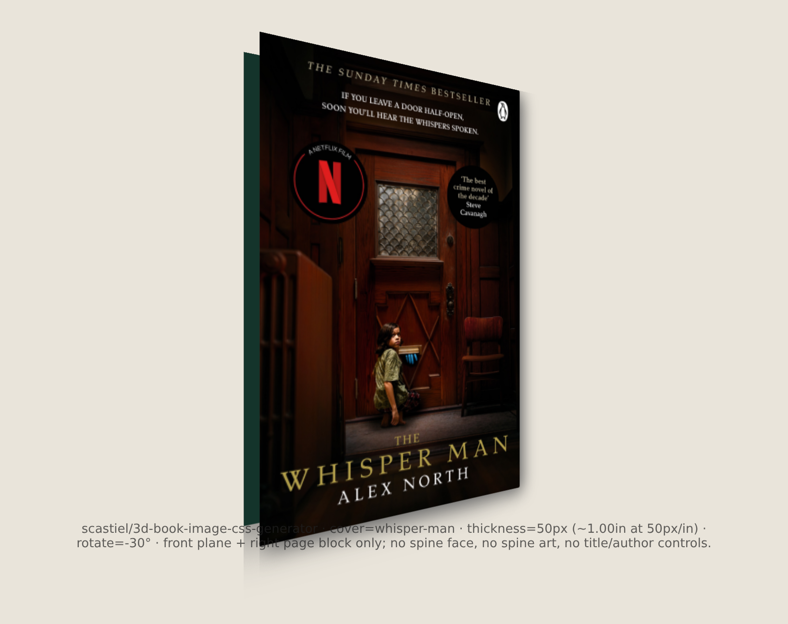
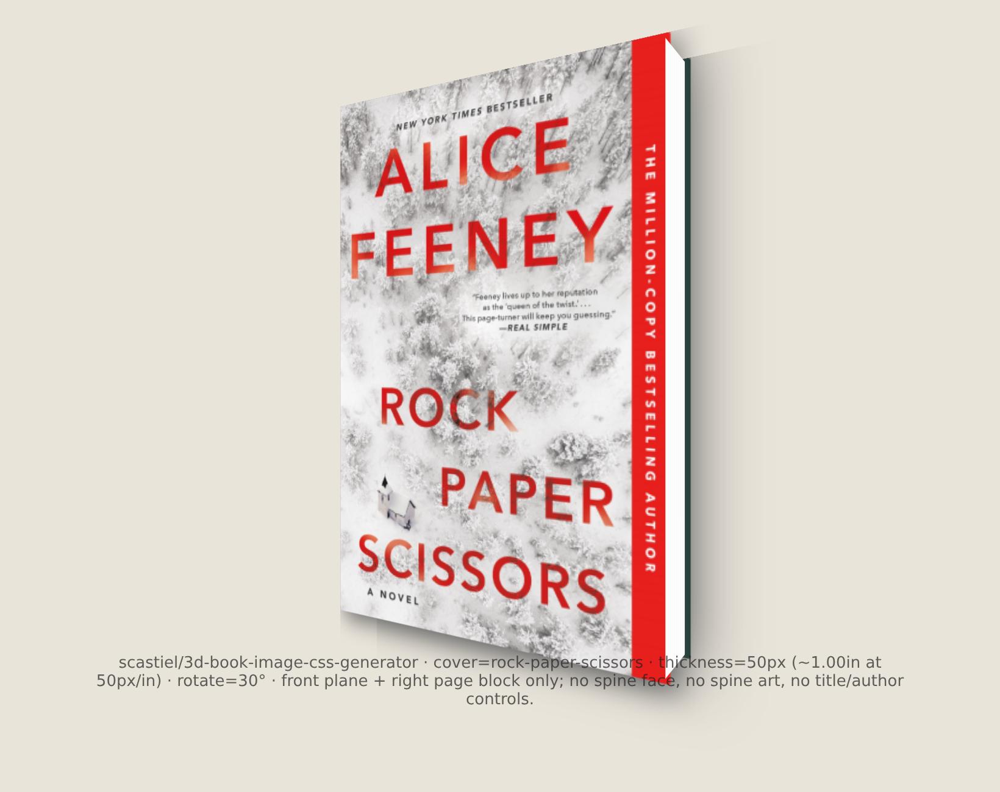
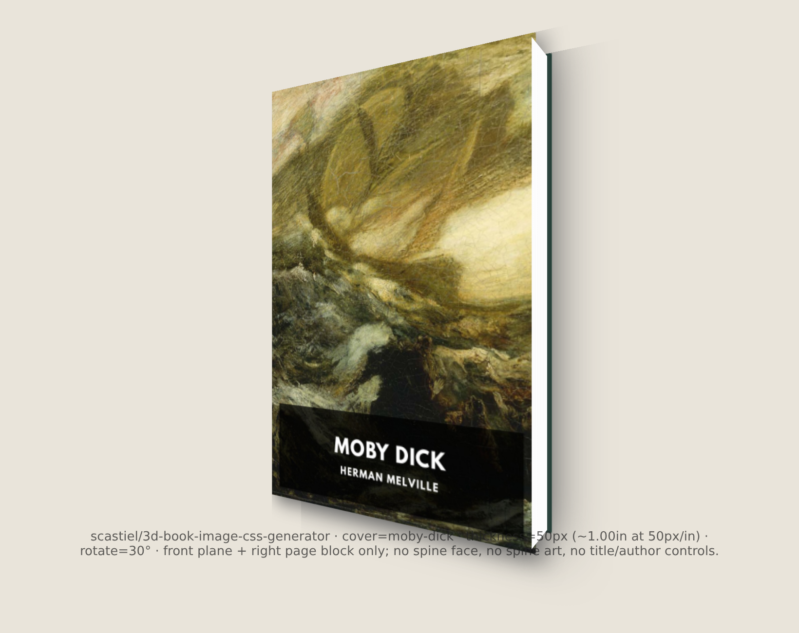

**What it actually generates:** a front-cover plane (`translateZ(+t/2)`), a back-cover plane (`translateZ(-t/2)`), and a right-edge page block (`rotateY(90deg)`). There is **no left spine face, no spine texture, no spine title/author**. The back cover is a solid `bgColor`. Thickness is a raw pixel value; no page count or paper stock. The 300 × 450 px front is a slight stretch of the 1303 × 2000 cover (0.6515 vs 0.6667 aspect); there is no crop control.

The Rock Paper Scissors screenshot looks as if it has a spine because that cover’s JPEG already contains a red spine strip on its right edge. The generator did not create it; it simply mapped the rightmost pixels of the front image onto the front plane. This is exactly the “believable spine” illusion to watch out for.

**Verdict:** good lightweight marketing mock for a front cover, not a spine solution.

The sibling React component `book-cover-3d` (npm, `scastiel/book-cover-3d`, 2020/2022) uses the same CSS approach and has the same limitations; it was inspected but not separately rendered because the visual output is identical to 4.1.

### 4.2 book-3d (React + Three.js)

| Item | Finding |
|---|---|
| Package | <https://www.npmjs.com/package/book-3d>, version 1.0.0 |
| Published | 2026-11-12 (brand new at test time) |
| Stack | React 18+, Three.js, `@react-three/fiber`, `@react-three/drei` |
| Licence | MIT (per README) |
| Repo metadata | No repository URL in npm metadata; low verifiability |
| Claim | “leather-wrapped spine that naturally sizes itself to your exact page count” |

Local harness: `comparables/book-3d-harness/` (React 19, R3F 9, Three 0.180, Vite 8). Screenshots with 1, 12 and 40 sheets:

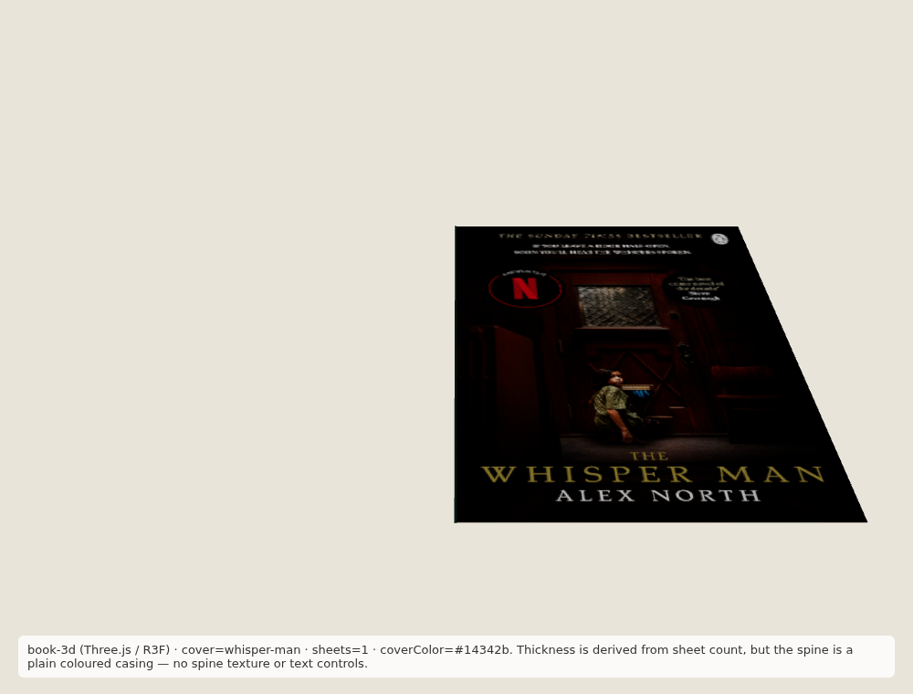
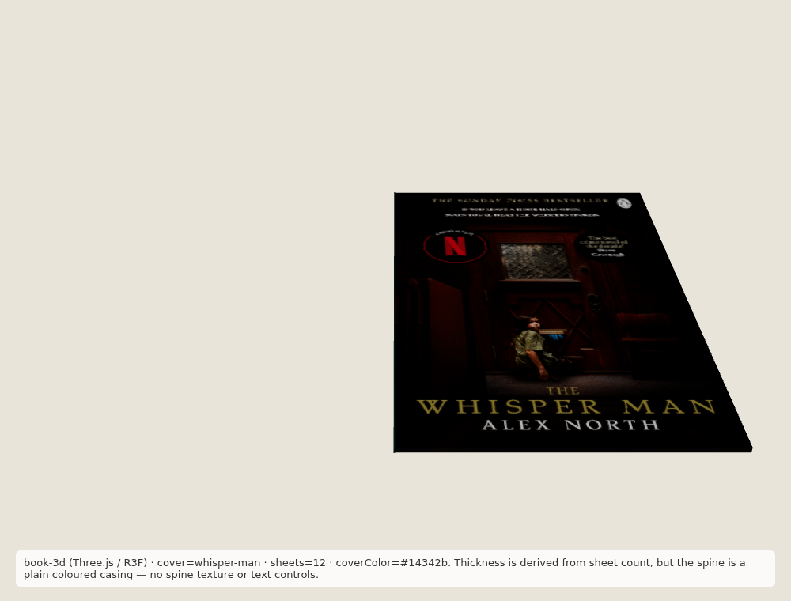
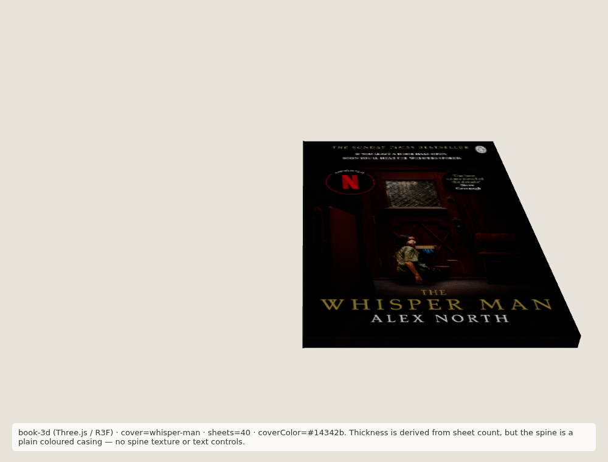
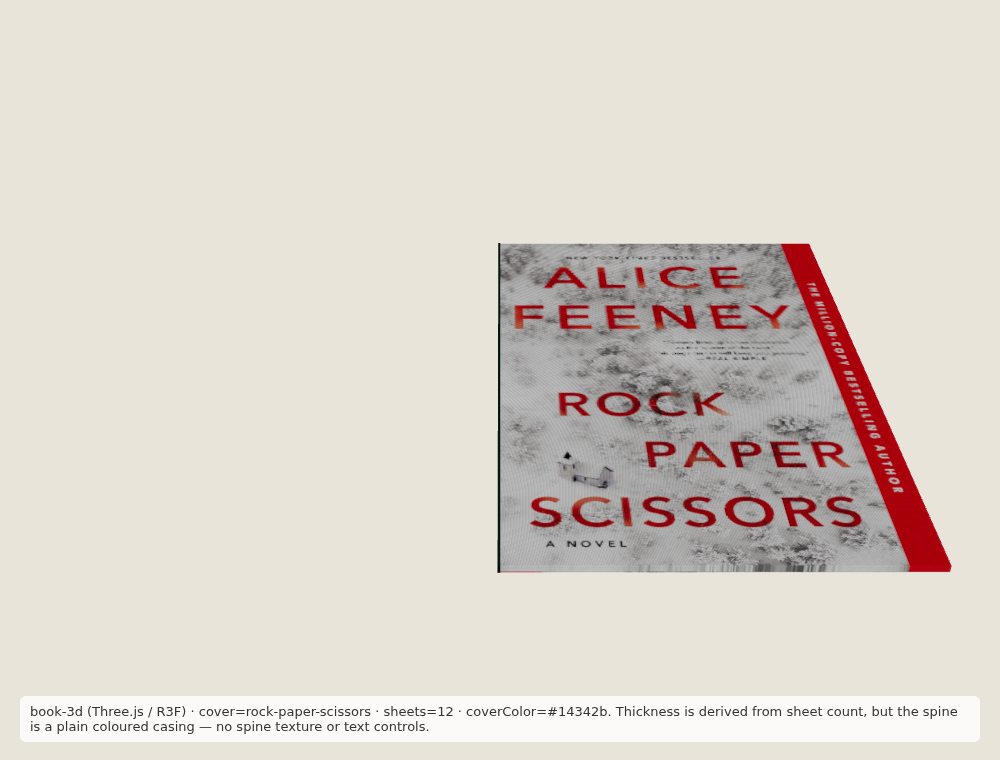
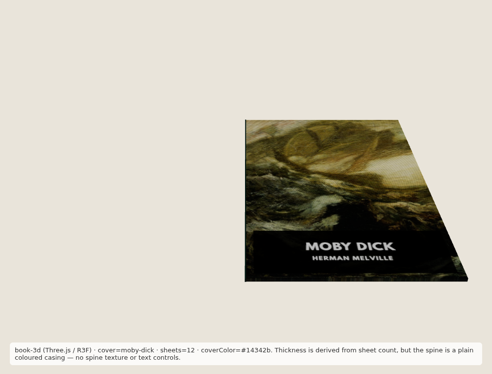

**What it actually generates:** a real Three.js/R3F 3D canvas; front-cover texture; page block; closed-book geometry. The spine is a plain box:

```js
bookThickness = totalSheets * 0.0035 + 0.004
<boxGeometry args={[0.014, bookThickness, height * 1.002]} />
<meshStandardMaterial color={coverColor} ... />
```

So page count **does** control thickness, but the spine is a single-colour material with **no texture map, no title/author, and no per-book artwork**. The explicit `thickness` prop is accepted but ignored in 1.0.0 (`_thickness`). The model has no real-world units; thickness is arbitrary scene units, not paper PPI. Textures had to be copied same-origin because the source 4173 server did not send CORS headers for WebGL textures.

**Verdict:** interesting proof that page-count-driven thickness is easy in Three.js, but not a production spine treatment; brand-new, no public repo metadata, no tests, no spine texture.

---

## 5. Recommendation for PocketLibrary

**Do not use bookcover-js for spine treatment.** The one narrow exception: if PocketLibrary deliberately wants a Penguin-clothbound *pastiche* for public-domain classics (not the real cover), its decorative spine presets can be a starting point at wide spines, but it still needs text fitting and wrap fixes. Reasons, in priority order:

1. It is a different product category: a Penguin-clothbound decorative print/cut template, not a cover mockup or wrap generator.
2. It cannot take the actual front cover (JPEG/PNG); its SVG art input is recoloured and tiled as an ornament.
3. It has no page count/paper model; spine width is a manual number, so the spine cannot respond to the book’s real thickness.
4. Its spine text does not fit itself: a valid 1 in spine clips “Whisper” at the default font size.
5. Its combined export is not a continuous wrap: 0.625 in gaps around the spine, missing outer margins, spine zone twice the requested width.
6. It is stale (last commit Aug 2024), has no library API/package, no tests, and 6 open issues.

**Do not adopt the tested 3D alternatives as spine solutions either.** The CSS generator is a front-cover-only mock with no spine face; `book-3d` has page-count thickness but a plain coloured spine box. Both could be useful as visual references, but neither derives a spine from the cover.

**Recommended approach:** build a small wrap compositor in-house:

1. Compute spine width from page count and paper stock (e.g. `pages / paper_ppi` plus cover board allowance), with a configurable paper presets table.
2. Build a single back + spine + front wrap texture at the correct aspect and bleed, or keep three panels but map them onto a real box with six materials.
3. Fit spine text using actual font metrics and a maximum-width/maximum-height constraint; support rotated and stacked modes, but never clip silently.
4. For a 3D preview, a plain `three` `BoxGeometry` with separate front/spine/back materials (or a small CSS-3D component) is enough. If a library is preferred, fork the small `book-3d` code or use `three` directly; do not take on bookcover-js’s template assumptions.

If the product goal is a *stylised* spine derived from the cover’s palette/art rather than the literal cover, that is also a custom feature: extract colours/patterns from the cover, then lay out spine text with fit constraints. None of the tested projects do this.

---

## 6. Artifact map (selected)

```text
.scratch/spine-cover-art-prototype/bookcover-js-test/
├── REPORT.md                         ← this file
├── index.html                        ← visual gallery
├── capture-bookcover.cjs             ← bookcover-js main matrix
├── inspect-bookcover.cjs             ← UI/API inspection
├── capture-3d-book-css.cjs           ← comparable A capture
├── capture-book-3d.cjs               ← comparable B capture
├── bookcover-js-src/bookcover-js-main/
├── captures/
│   ├── app-whisper-man.png
│   ├── live-site.png
│   ├── whisper-man-wrap.png
│   ├── whisper-man-spine.png
│   ├── whisper-man-spine-040.png
│   ├── whisper-man-spine-080.png
│   ├── whisper-man-spine-150.png
│   ├── rock-paper-scissors-wrap.png
│   ├── moby-dick-wrap.png
│   ├── raster-upload-front.png
│   ├── raster-upload-spine.png
│   ├── combined-preview.png
│   ├── whisper-man-combined.svg
│   ├── whisper-man-combined-10x.png
│   ├── metrics.json
│   └── app-inspection.json
└── comparables/
    ├── 3d-book-css/
    │   ├── book.html
    │   └── captures/
    └── book-3d-harness/
        ├── package.json
        ├── index.html
        ├── spine.html
        ├── src/main.jsx
        ├── src/spine.jsx
        └── captures/
```

Exact HTTP URLs while the `.scratch` server is running:

```text
http://127.0.0.1:4173/spine-cover-art-prototype/bookcover-js-test/index.html
http://127.0.0.1:4173/spine-cover-art-prototype/bookcover-js-test/bookcover-js-src/bookcover-js-main/index.html
http://127.0.0.1:4173/spine-cover-art-prototype/bookcover-js-test/comparables/3d-book-css/book.html?cover=whisper-man&thickness=50&rotate=30
```

---

## 7. Limitations

- The `book-3d` harness used React 19 / R3F 9, while its README targets React 18+; it rendered without console errors. Its package has no public repo link, so maintenance cannot be assessed beyond npm metadata.
- The CSS generator was tested by reproducing its generated CSS verbatim, not by driving its live React UI. The live demo now redirects to the author’s project page; the generated CSS is the actual output of the tool.
- bookcover-js’s default Garamond font was not installed; system serif fallback was used. This does not affect the clipping behaviour, which is caused by fixed font size and panel width.
- No commercial full-wrap mockup service (e.g. BookCoverly, Placeit) was tested; BookCoverly’s public repo is marketing copy without source. The two open-source comparables are sufficient to establish that “3D front-cover mock” and “spine treatment” are different problems.
- The 0.4 in and 0.8 in spine values are below the app’s `min="1"` input. They were set programmatically to expose the scaling behaviour; the 1.0 in case is a valid UI value and already clips, so the conclusion does not depend on out-of-range values.
