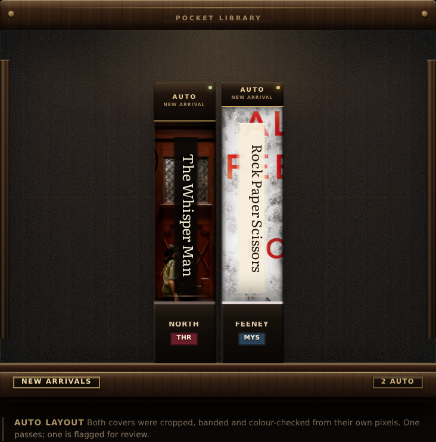
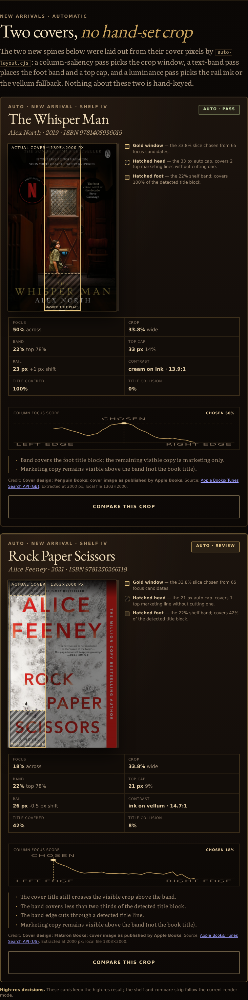
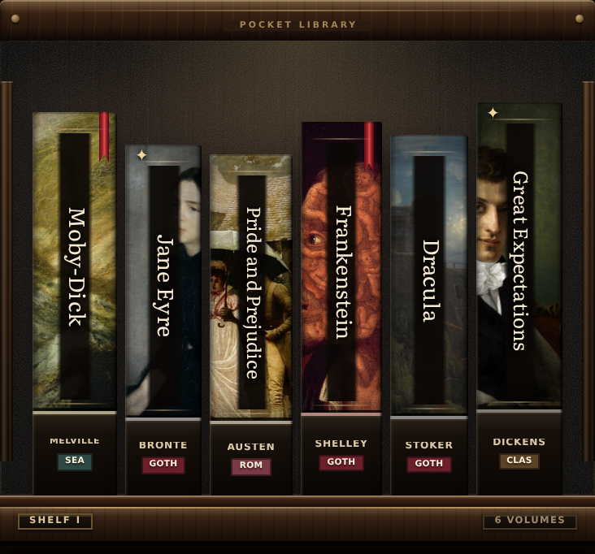
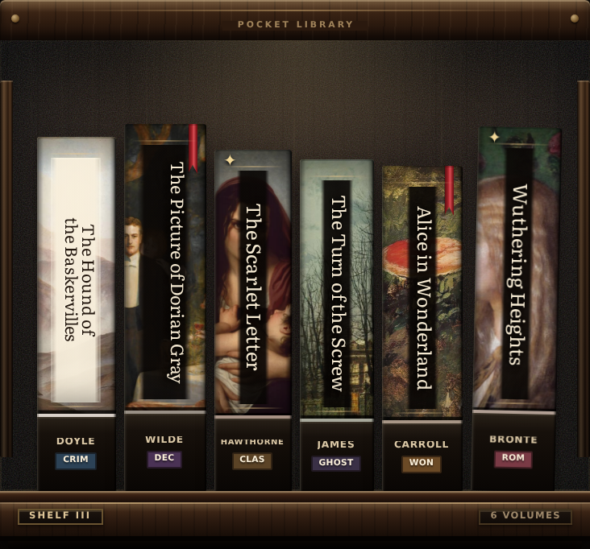
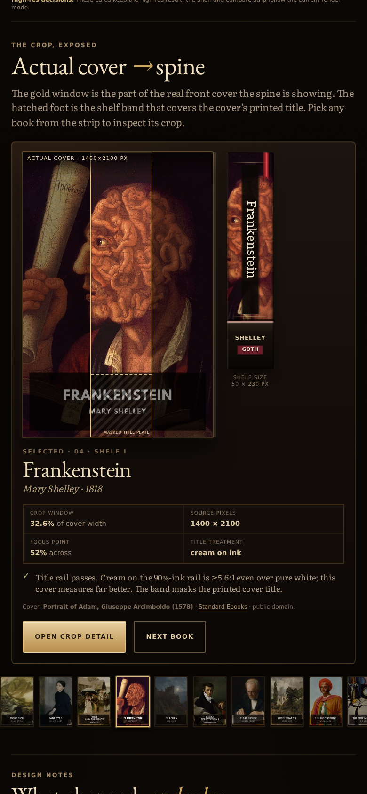
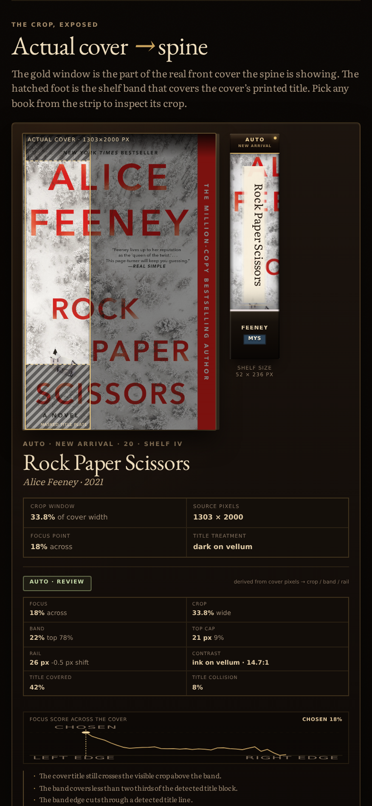

# v2 — Bound in its own cover

**Status:** throwaway design prototype, not production code. Everything lives in
`.scratch/spine-cover-art-prototype/v2/`; nothing outside it was modified.

**View:** `http://127.0.0.1:4173/spine-cover-art-prototype/v2/`  
(the `.scratch` folder is already served on `0.0.0.0:4173`)

**Question:** can variant B — full-height cover art on a 40–53 px spine — be made
genuinely good, and can the crop, shelf band and title rail be **derived
automatically** for a new cover instead of hand-set?



---

## The two new arrivals

Both were added to a fourth **New arrivals** shelf and laid out by
[`auto-layout.cjs`](auto-layout.cjs). Nothing about their focus, band, cap, rail
width, rail shift or ink colour is hand-keyed. The script writes
[`auto-layout.json`](auto-layout.json), which is embedded in the page and shown
under “Two covers, no hand-set crop”.

The editions were chosen deliberately and are recorded by ISBN: the **UK
Whisper Man** (Penguin, 9781405936019) has a foot title block the band can
actually mask, while the **US Rock Paper Scissors** (Flatiron, 9781250266118)
has integrated central typography and therefore acts as the honest failure
case. Both are real published covers, not substitutes.

| | The Whisper Man | Rock Paper Scissors |
|---|---|---|
| Edition / ISBN | Penguin Books UK, 2019 · **9781405936019** | Flatiron Books US, 2021 · **9781250266118** |
| Source | Apple Books/iTunes Search API (GB), 2000 px request → 1303 × 2000 | Apple Books/iTunes Search API (US), 2000 px request → 1303 × 2000 |
| Auto focus | **50%** across | **18%** across (left snow/church edge) |
| Crop at 390 px | **33.8%** of cover width | **33.8%** |
| Crop at 320 px | **29.1%** | **29.1%** |
| Foot band | 22% tall, top at 78% | 22% tall, top at 78% |
| Auto top cap | **33 px / 14%** — covers 2 marketing lines | **21 px / 9%** — covers 1 marketing line |
| Rail | 23 px, +1 px shift | 26 px, −0.5 px shift |
| Tone / contrast | cream on ink · **13.9:1** | dark ink on vellum · **14.7:1** |
| Title coverage | **100%** | **42%** |
| Title collision above band | **0%** | **8%** |
| Verdict | **AUTO · PASS** | **AUTO · REVIEW** |

### The Whisper Man — automatic pass

The cover is a dark doorway with a child at the lower left and a gold title
block in the bottom fifth. The pass picked **x = 50%**, which frames the child,
the stained-glass window and the door panel. The 22% foot band starts exactly at
the cover’s title block, so it masks `THE WHISPER MAN / ALEX NORTH` completely
(100% title coverage, 0% title collision). The top 14% is a second automatic
mask: it covers the two marketing lines above the door and doubles as the
`AUTO / NEW ARRIVAL` marker. A 23 px cream-on-ink rail sits over the door.

This is the success case. It also shows the limit of the heuristic: some
non-title copy is still inside the visible crop (20% of the marketing-band
sample), but none of it is the book title. A human would probably keep it.

### Rock Paper Scissors — automatic pass, and an honest failure

The cover is a light snow scene with the title stacked through the middle
fifth. The pass correctly chose the **vellum fallback** — measured rail contrast
**14.7:1** — but the crop is poor:

- The title block runs roughly **48–93% of the cover height**. No 18–30% foot
  band can cover it without taking half the spine, so the chosen 22% band cuts
  through a title line. Title coverage is only **42%**.
- To reduce title collision, the focus search ran away from the centre and chose
  **x = 18%**, a snow/church slice at the left edge. It avoids some red letters,
  but it also misses the paper-cutout figures that make the cover recognisable.
- The result is the spine in `14-shelf-auto-390.png`: a readable vellum rail
  surrounded by large red fragments of `ALICE / FEENEY / ROCK / PAPER /
  SCISSORS`. The automation says **REVIEW**, and the shelf caption says one
  passes and one does not.

This is not hidden. A human would either accept the printed title (and drop the
band on this cover), choose a centre crop on the paper figures with the title
deliberately visible, or use a different edition/cover. The old-style toggle
also flags this cover as a third AA failure (amber dot), because cream type over
the light snow fails without the vellum rail.



---

## How the automatic pass works

It is a deterministic, inspectable heuristic — not a learned model. Run it with:

```bash
node .scratch/spine-cover-art-prototype/v2/auto-layout.cjs
```

It needs Node plus `ffmpeg`/`ffprobe`; there is no image-library dependency.

1. **Decode and measure.** `ffmpeg` produces a 260 px working copy. The script
   computes relative luminance, saturation and Sobel edge magnitude.
2. **Find typography bands.** A row is “textish” when edge coverage is above 5%
   and the edge pixels span more than 50% of the width. Contiguous rows are
   merged into bands; bands in the bottom 55% are treated as the title block,
   bands above that as marketing.
3. **Choose the top cap.** Candidate caps between 7% and 16% are scored by how
   many top marketing lines they cover without straddling one. The cap doubles
   as the `AUTO / NEW ARRIVAL` mark and is shown as a hatched head in the
   compare strip. *The Whisper Man* gets 14%; *Rock Paper Scissors* gets 9%.
4. **Search focus × band jointly.** 65 horizontal focus positions are crossed
   with 7 band heights (18–30%). Each candidate scores edge/saturation saliency
   plus a centre prior, minus title collision and band-cut penalties, plus title
   coverage. The chosen window is centred on the best-scoring column.
5. **Choose the ink from the pixels.** The visible crop is sampled above the
   band: mean / p05 / p95 luminance, bare cream contrast and bare dark-ink
   contrast. If dark ink on vellum beats cream on ink on a light crop, the
   vellum fallback wins. *Rock Paper Scissors* triggers this path; *The Whisper
   Man* does not.
6. **Size and place the rail.** The rail width starts from the title’s one- or
   two-column type width, then adds contrast/busyness padding. Its centre is
   shifted up to ±2.5 px toward the calmer half of the crop’s edge profile.
7. **Declare pass or review.** A cover passes when title collision is ≤2%, title
   coverage is ≥65% and no title line is cut. Otherwise it is marked **REVIEW**
   with the reasons in the page and in `auto-layout.json`.

The 18 classics still use hand-declared focus points. The two new arrivals
demonstrate the automated path, including one clean pass and one review.

When the prototype is served over HTTP it re-reads `auto-layout.json` on load,
so rerunning the script and refreshing the page updates the shelf. The embedded
copy of the decisions is the fallback for a direct `file://` view.

---

## What changed from v1 (and the first v2)

1. **Twenty books, four cases.** The original 18 classics remain on Shelves
   I–III; the two new arrivals sit on Shelf IV as a display. The existing
   comparisons are unchanged.
2. **A wider, curated crop.** At 390 px a 52 × 236 px spine shows **33.8%** of
   the 1303 px cover width. The classics show 31–34% of their 1400 px covers.
   v1’s 30 px spine plus 1.45× zoom showed about **14%**.
3. **The printed cover title is masked.** A 22%-height ink band covers the foot
   title block on the classics and on *The Whisper Man*. On *Rock Paper
   Scissors* the title block is too tall, and the automation says so.
4. **Type gets a floor.** The title sits in a narrow smoked-glass rail at ≥90%
   ink: ≥5.6:1 for cream even over pure white. Light covers switch to dark ink
   on a warm vellum rail (≥14:1). *The Hound of the Baskervilles* and *Rock
   Paper Scissors* use the fallback.
5. **A top cap for modern covers.** Standard Ebooks covers have no top
   marketing; trade covers do. The new arrivals get an automatic 9–14% top cap
   that covers marketing copy and carries the `AUTO` marker.
6. **Real assets at real resolution.** The classics are 1400 × 2100 px sources;
   the new arrivals are 1303 × 2000 px. Shelves use 480/800 px `image-set`
   responses; the compare strip and detail sheet use the full source. The old
   420 px copies are kept only for the old-style toggle. Everything is local.
7. **A compare strip that proves the match.** In high-res mode the gold window
   is drawn on the actual cover, with a hatched head for the auto cap and a
   hatched foot for the shelf band. In old-style mode the window shrinks to
   v1’s centre crop and drops the hatches.
8. **A lift state that explains the crop.** Tapping any spine opens the detail
   sheet: cover + crop window + real shelf-size spine + metadata + credit. For
   auto books it also states the automatic decision.





---

## Controls

- **High-res / Old-style** toggles the shelf between the v2 pipeline and the v1
  pipeline (420 px source, 1.45× centre crop, flat guard). The auto cards keep
  the high-res decision and say so.
- **Tap / click a spine** lifts it and opens the crop detail sheet.
- **Tap a filmstrip cover** changes the selected compare card. Auto items carry
  a small `AUTO` badge.
- **Compare this crop** on an auto card selects it in the compare strip.
- **Open crop detail** opens the detail sheet for the selected book.
- Keyboard: all controls are buttons; Escape closes the sheet; focus is visible.

---

## Honest numbers

The shelf is responsive: spines narrow with the viewport, heights stay fixed.
Crop percentages are measured from the rendered widths, not the base design.

| Viewport | Classic example | Classic crop | Auto spine | Auto crop |
|---|---|---|---|---|
| 390 px | 50 × 230 px | **32.6%** | 52 × 236 px | **33.8%** |
| 360 px | 49 × 230 px | **32.0%** | 51 × 236 px | **33.2%** |
| 320 px | 43 × 230 px | **28.1%** | 45 × 236 px | **29.1%** |

- v1 reference: 30 px spine, 1.45× zoom → about **14%** of cover width.
- Title rail floor: **≥5.6:1** worst case (cream on ≥90% ink over white). Vellum
  fallback: **≥14:1** dark ink on warm paper.
- Auto measurements: *The Whisper Man* 13.9:1, 100% title coverage, 0% title
  collision; *Rock Paper Scissors* 14.7:1, 42% title coverage, 8% title
  collision, 1 cut title line.
- All 20 titles fit without clipping at 390 / 360 / 320.
- No horizontal overflow at 390 / 360 / 320 (`scrollWidth === clientWidth`;
  `body.scrollWidth === clientWidth`). The filmstrip is a contained horizontal
  scroller.
- No console errors, page errors or failed requests in the capture run. The
  old-style audit now shows **three** AA risk dots: Hound, Turn of the Screw,
  and Rock Paper Scissors.

**Caveat:** the contrast figures are computed against the rail/paper, not
sampled from the final composited pixels of every cover. They are a design
guarantee, not a per-pixel accessibility audit. The auto crop is a heuristic
judgement, not a semantic understanding of the cover.

---

## Screenshots

Fresh Chromium captures at 2× DPR, in this folder:

| File | What it shows |
|---|---|
| `01-hero-390.png` | Masthead and first shelf at 390 px |
| `02-shelf-high-390.png` | Shelf I, high-res, close-up |
| `03-shelf-hound-390.png` | Shelf III, including the vellum fallback |
| `04-compare-high-390.png` | Actual cover → crop window → spine |
| `05-detail-hound-390.png` | Lifted detail sheet for the light cover |
| `06-shelf-old-390.png` | Old-style shelves |
| `07-compare-old-390.png` | Old-style compare card |
| `08-full-390.png` | Full page, 390 px |
| `09-hero-360.png`, `10-shelf-high-360.png`, `11-compare-360.png`, `12-detail-hound-360.png` | 360 px pass |
| `09-hero-320.png`, `10-shelf-high-320.png`, `11-compare-320.png`, `12-detail-hound-320.png` | 320 px pass |
| `13-high-vs-old-390.png` | Same classic shelf, high-res vs old-style |
| **`14-shelf-auto-390.png`** | **New-arrivals shelf: pass and review** |
| **`15-auto-section-390.png`** | **The two automatic cards, metrics and focus curves** |
| **`16-compare-whisper-390.png`** | **The Whisper Man auto crop, pass** |
| **`17-compare-rps-390.png`** | **Rock Paper Scissors auto crop, review** |
| **`18-detail-rps-390.png`** | **Detail sheet for the failed auto crop** |
| **`19-shelf-auto-320.png`**, **`20-auto-section-320.png`**, **`21-compare-auto-320.png`** | **320 px auto pass** |

Reproduce:

```bash
# from the repo root, with .scratch already served at 127.0.0.1:4173
node .scratch/spine-cover-art-prototype/v2/auto-layout.cjs
node .scratch/spine-cover-art-prototype/v2/capture.cjs
```

The capture script writes `audit.json` with overflow, title-clipping,
interaction and console results.





---

## Remaining questions

- **The review case is the useful one.** *Rock Paper Scissors* shows that a
  33% spine crop cannot carry a cover whose title block occupies half the
  height. Should the ingest pipeline reject such covers, try a different
  edition, or accept visible printed type?
- **Semantic saliency.** Edge/colour saliency chose the left snow/church edge on
  RPS instead of the paper figures. Face/object detection might fix this, but it
  would add a model and a dependency. Is the current “show the failure” contract
  enough?
- **Top marketing copy.** The auto cap handles lines near the head, but it
  cannot fix wide promotional bands without eating art. Modern covers vary more
  than the Standard Ebooks set.
- **Band or no band?** On integrated-typography covers, a foot band can cut a
  title line. A per-cover “no band, accept the printed title” branch may be
  better than forcing the house style.
- **Density:** does a two-book New arrivals case read as a display, or does it
  look like an empty shelf?
- **Asset weight:** 20 shelf images at 800 px plus 20 old images is fine for a
  prototype. The production question is still decode/paint cost on a mid-range
  Android WebView during shelf scroll.
- **Touch targets:** 39–53 px spines are wider than v1 but still below 44 px at
  320. Does art improve hit accuracy enough?

---

## Cover sources & licence

The 18 classics were downloaded on 2026-11-26 from
[Standard Ebooks](https://standardebooks.org/), which states that its text and
cover art are believed to be in the U.S. public domain and dedicates its own
work to the public domain. The source paintings named below are public domain.

The two new arrivals were sourced from the **Apple Books/iTunes Search API**, a
free, keyless endpoint, at its `2000x2000bb` artwork size. Open Library was
tried first: its largest available cover for these editions was 500 px on the
long edge, which is not a high-resolution source. The Apple Books artwork
returned 1303 × 2000 px files with the ISBN in the filename. These are modern
edition covers used only as design references in this throwaway prototype; they
are not public domain. Machine-readable attribution, including edition ISBNs
and exact artwork URLs, is in [`sources.json`](sources.json). Public-domain
status can differ by jurisdiction; this is a design study, not legal advice.

| Book | Cover art / edition |
|---|---|
| Moby-Dick | *The Flying Dutchman*, Albert Pinkham Ryder (1887) · Standard Ebooks |
| Jane Eyre | *Portrait of a Young Girl*, Vilhelm Hammershøi (1903–04) · Standard Ebooks |
| Pride and Prejudice | *A Wet Sunday Morning*, Edmund Blair Leighton (1896) · Standard Ebooks |
| Frankenstein | *Portrait of Adam*, Giuseppe Arcimboldo (1578) · Standard Ebooks |
| Dracula | *Italian Landscape of Ruins in the Moonlight*, Joseph Magnus Stäck (1850) · Standard Ebooks |
| Great Expectations | *Self-Portrait*, Joseph Paelinck (1812) · Standard Ebooks |
| Bleak House | *The Writing Master*, Thomas Eakins (1882) · Standard Ebooks |
| Middlemarch | *The Grove, Hampstead*, John Constable (1821–22) · Standard Ebooks |
| The Moonstone | *Study for “Portrait of an Indian”*, Anne-Louis Girodet Roussy-Trioson (1807) · Standard Ebooks |
| The Time Machine | *The Black Marble Clock*, Paul Cézanne (c. 1870) · Standard Ebooks |
| Treasure Island | *One More Step, Mr. Hands*, N. C. Wyeth (1911) · Standard Ebooks |
| Dr Jekyll and Mr Hyde | *Double Portrait of Marées and Lenbach*, Hans von Marées (1863) · Standard Ebooks |
| The Hound of the Baskervilles | *Riesengebirgslandschaft mit aufsteigendem Nebel*, Caspar David Friedrich (1820) · Standard Ebooks |
| The Picture of Dorian Gray | *The Garden*, John Collier (1899) · Standard Ebooks |
| The Scarlet Letter | *The Scarlet Letter*, Hugues Merle (1861) · Standard Ebooks |
| The Turn of the Screw | *A Wintry Moon*, John Atkinson Grimshaw (1886) · Standard Ebooks |
| Alice in Wonderland | *Amanita*, Ivan Shishkin (1879) · Standard Ebooks |
| Wuthering Heights | *Edith Villiers*, George Frederic Watts (1862) · Standard Ebooks |
| The Whisper Man | Penguin Books UK cover, 2019 · ISBN 9781405936019 · Apple Books (GB) |
| Rock Paper Scissors | Flatiron Books US cover, 2021 · ISBN 9781250266118 · Apple Books (US) |

The two typefaces copied into this folder are EB Garamond and Literata, both
under the SIL Open Font License; their OFL texts are included.

---

## Files

```
.scratch/spine-cover-art-prototype/v2/
  index.html                    single-file prototype (data, CSS, JS)
  auto-layout.cjs               deterministic cover analysis → auto-layout.json
  auto-layout.json              crop / band / cap / rail / contrast decisions
  capture.cjs                   Playwright screenshots + audit
  audit.json                    generated 390/360/320 overflow and console audit
  sources.json                  machine-readable 20-cover attribution
  covers/
    source/                     18 × 1400 × 2100 + 2 × 1303 × 2000 JPEG originals
    shelf/                      20 × 480 and 800 px image-set responses
    old/                        20 × 420 px v1 copies (old-style mode)
    thumbs/                     20 × 120 px filmstrip thumbnails
  screenshots/                  fresh captures listed above
  EBGaramond-Regular.woff2
  Literata-Regular.woff2
  OFL-EBGaramond.txt
  OFL-Literata.txt
  README.md
```

**Deliberately not done:** no production files, tests, manifests or existing
specs were changed; no persistence, backend or real reader; no commits, tags or
releases. The old 420 px files are retained only so the mode toggle is honest
about the comparison. The RPS failure is left visible on purpose.
