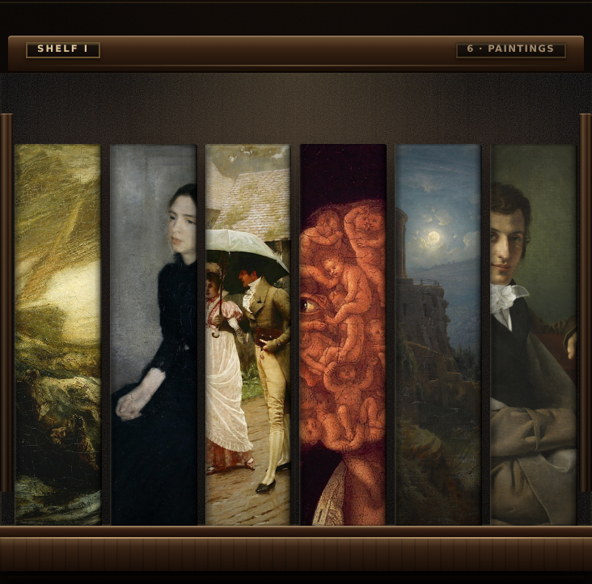
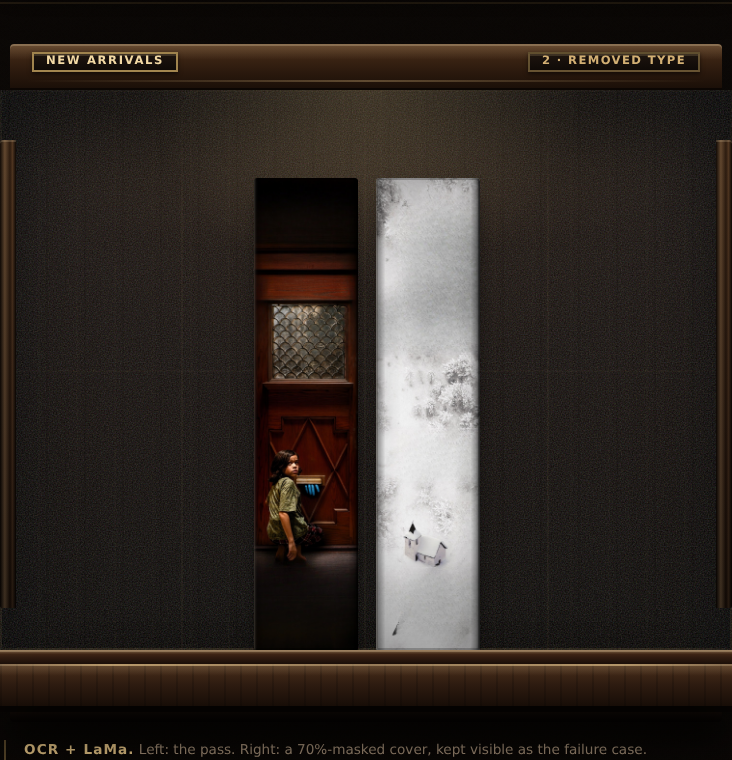
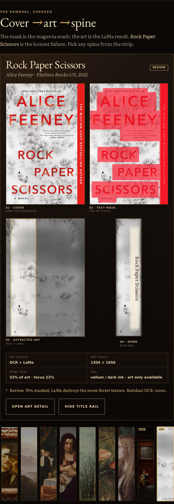

# v3 — The cover, unprinted

**Status:** throwaway design prototype, not production code. Everything lives in
`.scratch/spine-cover-art-prototype/v3/`; nothing outside it was modified except
a link in v2.

**View:** `http://127.0.0.1:4173/spine-cover-art-prototype/v3/`  
(the `.scratch` folder is served on `0.0.0.0:4173`)

**Question:** can the spine use **only the cover artwork**, with the cover's
printed title, author, quotes and badges removed — and what does it take to get
there honestly?



---

## What it is

Twenty spines, four shelves. There is no text-masking foot band and no top cap:
the printed cover text is either **not in the source** or has been **removed**.
The only overlay left is the app's own title rail, and that is a toggle:

- **Art only** — zero type on the spine.
- **With title rail** — the app's smoked-glass / vellum rail, which is UI text,
  not printed cover text.

The compare card shows the full chain: **published cover → text mask / plate
excluded → extracted artwork → spine crop**; the detail sheet shows the same
spine art-only and with the rail.



---

## Genuine textless art vs inpainted art

| | Books | Method | Result |
|---|---|---|---|
| **Genuine textless** | 15 classics | Original public-domain painting from Wikimedia Commons, cropped 2:3 | *Moby-Dick*, *Jane Eyre*, *Pride and Prejudice*, *Dracula*, *Great Expectations*, *Bleak House*, *Middlemarch*, *The Moonstone*, *The Time Machine*, *Treasure Island*, *Dr Jekyll and Mr Hyde*, *The Hound of the Baskervilles*, *The Picture of Dorian Gray*, *The Scarlet Letter*, *Wuthering Heights* |
| **Genuine textless, cover crop** | 3 classics | The un-type-set top of the Standard Ebooks cover, above its printed plate; no inpainting | *Frankenstein*, *The Turn of the Screw*, *Alice* |
| **Inpainted** | 2 modern | RapidOCR + manual mask + LaMa big-lama on CPU | *The Whisper Man* (pass), *Rock Paper Scissors* (review / failure) |
| **Genuine textless found for the modern covers** | **none** | — | The RPS designer portfolio shows the published cover; the UK *Whisper Man* photo is a licensed stock image; the US *Whisper Man* is a different butterfly/hand cover. |

So: **18/20 classics are genuine text-free art**, and **2/20** are reconstructions.
The three cover-crop classics are labelled “Cover crop above plate” in the page
and in `sources.json`; they are a crop, not an inpaint.

The full research, including why no public textless prose-cover archive exists,
is in [**RESEARCH.md**](RESEARCH.md).

---

## The two modern covers

### The Whisper Man — Penguin UK, ISBN 9781405936019

The cover is a dark doorway with a child at the lower left, a Netflix badge, a
quote sticker, a top bestseller line, and the gold title block in the bottom
fifth. The artwork is a licensed stock photograph (a German edition credits
Hanka Steidle/Arcangel Images for the motif); no free textless file was found.

Method: OCR found 13 boxes; manual polygons added the title and marketing
rectangles; the union mask is **38.8%** of the cover (including the stickers);
LaMa on CPU took **105.3 s**; a second OCR pass found no residual text.

**Verdict: pass.** The dark wood/door is a low-frequency surface LaMa can
continue; the child, window and door survive. The reconstructed sticker areas
are soft, but at 56 px they read as door/wood, not as damage. This is the case
where OCR + inpainting is a reasonable production fallback.

### Rock Paper Scissors — Flatiron US, ISBN 9781250266118

The cover is an aerial snow-forest photograph with red display type stacked
through the middle half, a quote block, a New York Times line, and a red
right-hand marketing band. The designer is Lisa Amoroso; her portfolio shows
the published cover only. No textless file was found.

Method: OCR found 17 boxes but missed the full display words (`ALI`/`ICE`,
`FE`/`EENE`, `RO`); manual polygons covered `ALICE`, `FEENEY`, `ROCK`, `PAPER`,
`SCISSORS`, `A NOVEL`, the quote, the NYT line and the red band. The mask is
**70.4%** of the cover; LaMa took **104.7 s**; residual OCR is none.

**Verdict: review / fail.** Removing the text also removes the forest. The
church and some tree clusters survive; the rest is a grey, textureless gradient.
At spine scale the RPS spine is a pale snow strip with a small church at the
bottom. This is left visible on purpose: it is the case that should trigger a
different edition, a typographic spine, or a licensed textless asset.



---

## How the art is prepared

- **Classics, original route.** Download the painting from Wikimedia Commons at
  1,800 px; crop to 2:3 around a recorded focus point; write a 160 × 727 spine
  crop. No typography is present. The source page and the painting credit are
  in `sources.json`.
- **Classics, cover-crop route.** Use the Standard Ebooks cover but crop above
  its printed title plate (the plate starts at ~74.4% of the height). This is a
  crop of PD art, not an inpaint; labelled “Cover crop above plate”.
- **Modern route.** OCR + manual mask + LaMa; then crop to 2:3 around a recorded
  focus. The mask, the result and the residual-OCR audit are all local.
- **Spine geometry.** At 390 px the six-book shelves give each spine about
  53.8 × 236 px; the 2:3 art means the spine shows **~34.2%** of the art width.
  At 320 px it is about **27.7%**. The two new arrivals use a fixed 52 px display
  spine (46 px at 320), showing **~34%** / **~30%** of their 1303 × 2000 art.
- **No old text masks.** The v2 foot band (22%) and top cap (9–14%) are gone.
  The only shading left is a 2 px edge and a soft top/bottom vignette for shelf
  realism; it does not hide printed text.
- **Rail tone.** Light spine crops use a warm vellum rail with dark ink; dark
  crops use a smoked rail with cream. The rail width is 40–42% of the spine and
  is placed on the calmer side of the **spine crop** (Sobel column busyness),
  not the whole painting.

---

## Controls

- **Art only / With title rail** — the only type toggle. Art only is the default.
- **Tap/click a spine** — opens the detail sheet: art-only vs rail, the full art
  with the gold spine-crop window, mask/OCR metrics, source and licence.
- **Filmstrip** — select a book for the compare card. The two modern books carry
  an `OCR` badge.
- **Open art detail** — the same sheet from the compare card.
- **Escape** closes the sheet; all controls are buttons; focus is visible.

---

## Honest numbers

| Viewport | Classic spine | Classic art shown | New-arrival spine | New-arrival art shown |
|---|---|---|---|---|
| 390 px | 53.8 × 236 px | **34.2%** | 52 × 236 px | **33.8%** |
| 360 px | 49.8 × 236 px | **31.7%** | 52 × 236 px | **33.8%** |
| 320 px | 43.5 × 236 px | **27.7%** | 46 × 236 px | **29.9%** |

- **Modern removals:** Whisper Man 38.8% masked / 13 OCR boxes / 105.3 s /
  no residual OCR / pass. RPS 70.4% masked / 17 OCR boxes / 104.7 s / no
  residual OCR / **review**.
- **Art assets:** 20 full art files (2:3) + 20 spine crops; the modern originals
  are 1303 × 2000, the classics are the downloaded painting crops (900–1,650 px
  short edge after the 1,800 px request).
- **No overflow** at 390 / 360 / 320 (`scrollWidth === clientWidth` and
  `body.scrollWidth === clientWidth`).
- **No clipped rail titles** at 390 / 360 / 320, in both rail modes.
- **No console errors, page errors or failed requests** in the capture run.
- **All 23 images load**; the full-page 390 screenshot is `13-full-390.png`.
- **Caveat:** the OCR/inpaint audit proves text is no longer machine-readable;
  it does not prove the background is the original. RPS is the counter-example.

---

## Screenshots

Fresh Chromium captures at 2× DPR, in `screenshots/`:

| File | What it shows |
|---|---|
| `01-hero-390.png` | Masthead and the art-only shelf |
| `02-shelf-art-390.png` | Shelf I, art only |
| `03-shelf-classics-390.png` | Shelf III, including the vellum/light covers |
| `04-new-arrivals-390.png` | The two removed-type covers, art only |
| `05-shelf-rail-390.png` | Shelf I with the app title rail |
| `06-new-arrivals-rail-390.png` | The modern covers with the rail |
| `07-compare-classic-390.png` | Original painting → art → spine |
| `08-compare-whisper-390.png` | The Whisper Man mask/removal/pass |
| `09-compare-rps-390.png` | The RPS 70% mask and the failure |
| `10-detail-rps-390.png` | Detail sheet: art-only vs rail, full damage |
| `11-detail-art-390.png` | Detail sheet for a classic |
| `12-research-390.png` | The research summary on the page |
| `13-full-390.png` | Full page at 390 px |
| `14-hero-360.png`, `15-shelf-art-360.png`, `16-new-arrivals-360.png`, `17-shelf-rail-360.png`, `18-compare-rps-360.png`, `19-detail-rps-360.png` | 360 px pass |
| `14-hero-320.png`, `15-shelf-art-320.png`, `16-new-arrivals-320.png`, `17-shelf-rail-320.png`, `18-compare-rps-320.png`, `19-detail-rps-320.png` | 320 px pass |

Reproduce:

```bash
node .scratch/spine-cover-art-prototype/v3/tools/build-data.mjs
node .scratch/spine-cover-art-prototype/v3/capture.cjs
```

`capture.cjs` writes `audit.json` with overflow, title-clipping, image-load and
console results.

---

## Cover sources & licence

**Classics:** the 15 original paintings are public domain; each was downloaded
from Wikimedia Commons on 2026-11-26. The three cover-crop fallbacks are derived
from Standard Ebooks covers, which Standard Ebooks dedicates to the public
domain. Painting credits are in `sources.json` and in the page's source list.

**Modern:** *The Whisper Man* is the Penguin Books UK edition (ISBN
9781405936019), sourced from the Apple Books/iTunes Search API at 2000 px.
*Rock Paper Scissors* is the Flatiron Books US edition (ISBN 9781250266118),
same source. These are modern edition covers used only as design references in
this throwaway prototype; they are **not public domain**. Their textless
derivatives inherit the same rights. No production use is implied.

**Fonts:** EB Garamond and Literata, SIL Open Font License; the OFL texts are
included. The v3 page is self-contained except for the v2 link.

**Tool licences:** RapidOCR (Apache-2.0), LaMa / simple-lama-inpainting
(Apache-2.0). See `RESEARCH.md` for the non-commercial caveats around MAT and
the SCUT-EnsText-based scene-text models.

---

## Files

```
.scratch/spine-cover-art-prototype/v3/
  index.html                  single-file prototype (data loaded from data.js)
  data.js                     embedded 20-book metadata for file:// fallback
  sources.json                machine-readable attribution (20 books)
  RESEARCH.md                 removal tools + textless-art sources + tests
  README.md                   this file
  tools/
    remove-text.py            RapidOCR + manual mask + LaMa big-lama
    make-classic-art.py       2:3 art crops + 160 × 727 spine crops
    fetch-classic-art.mjs     Wikimedia download helper
    build-data.mjs            data.js / sources.json builder
  assets/
    classic-covers/           18 published Standard Ebooks covers (text for compare)
    classic-originals/        15 original public-domain paintings
    whisper-man-cover.jpg     1303 × 2000 published cover
    rock-paper-scissors-cover.jpg
  art/                        20 textless 2:3 art files + manifest.json
  masks/                      modern mask PNGs, magenta previews, OCR audit JSON
  removed/                    modern LaMa results
  crops/                      20 × 160 × 727 spine crops (compare strip + filmstrip)
  screenshots/                fresh 390/360/320 captures
  EBGaramond-Regular.woff2
  Literata-Regular.woff2
  OFL-EBGaramond.txt
  OFL-Literata.txt
  capture.cjs
  audit.json
```

**Deliberately not done:** no production files, tests, manifests or existing
specs were changed; no commits, tags or releases. v1 and v2 are intact; v2 only
gained a small link to v3. The RPS failure is left visible on purpose. This is **front-cover artwork on a spine**, not a scan of the printed spine: real spines are separately typeset and often differ. No public spine-art archive exists.
