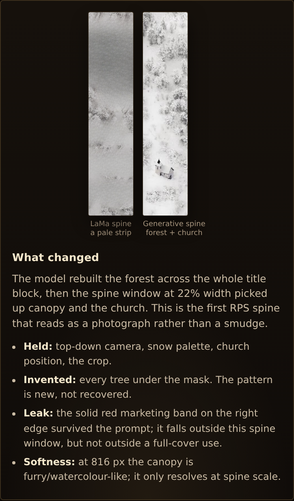

# v4 — Can a model invent the art back?

**Status:** throwaway design prototype, not production code. Everything lives in
`.scratch/spine-cover-art-prototype/v4-generative/`; nothing outside it was
modified.

**View:** `http://127.0.0.1:4173/spine-cover-art-prototype/v4-generative/`
(the `.scratch` folder is served on `0.0.0.0:4173`).

**Question:** v3 showed that OCR + LaMa works only for modest masks. On *Rock
Paper Scissors* a 70.4% mask erased the forest; *The Whisper Man* was a
borderline pass. Can an instruction-driven generative image editor reconstruct
the artwork under large typography better than LaMa?



---

## Verdict

**Conditioned generative editing is a real step change over LaMa. It is not an
automated route.**

- **Usable:** both modern covers came back fully text-free with the scene intact.
  The RPS spine becomes a real snow forest instead of a grey strip; the Whisper
  Man stickers are removed more cleanly than v3's LaMa patches. RapidOCR found
  **0** residual words on both edits.
- **Not viable unattended:** the model invents every pixel under the type,
  leaks instructions (the RPS red band survived), re-renders faces and hardware,
  needs a GPU, and is not mask-conditioned — there is no “untouched pixels stay
  untouched” contract. Human review is mandatory.

The honest framing is **offline art restoration with review**, not a batch
pipeline. If a licensed textless asset exists, use it. Otherwise a typographic
spine is more truthful than an invented forest.

---

## What was tested

| # | Case | Strategy | Model | Outcome |
|---|---|---|---|---|
| A | Rock Paper Scissors | Direct edit of the published cover | FLUX.1 Kontext Dev | **Usable** — forest reconstructed, church kept |
| A | The Whisper Man | Direct edit of the published cover | FLUX.1 Kontext Dev | **Usable** — badges/type gone, child/door kept |
| B | Rock Paper Scissors | Prompt only, no cover input | SANA via Pollinations | **Unusable** — different angle, palette and church |
| B | The Whisper Man | Prompt only, no cover input | SANA via Pollinations | **Unusable** — a different, empty hallway |
| C | Moby-Dick | Genuine public-domain painting | none | **Control** — actual textless art, no model |
| D | Rock Paper Scissors | Generative repair of the LaMa hole | FLUX.1 Kontext Dev | **Blocked** — ZeroGPU quota exhausted |
| E | Both | Dedicated tall-canvas spine outpaint | — | **Not run** — quota exhausted |

### Outpainting / uncrop

The title-band reconstruction is itself an uncrop: in *The Whisper Man* the
model continued the floor and door sill down through the gold title block; in
*Rock Paper Scissors* it continued the forest to the bottom edge. Both are
plausible. A separate tall-canvas outpaint into a 160 × 727 spine was planned
but not run once the anonymous GPU quota was exhausted. The spine shown here is
a deterministic crop of the reconstructed 816 × 1264 art.

---

## The original vs the reconstruction

The page includes a **Moby-Dick** control: the Standard Ebooks cover (painting
plus a black title plate) and Albert Pinkham Ryder's *The Flying Dutchman*, the
genuine public-domain painting. The textless art and spine are plain crops — no
model.

This makes the distinction visible:

| | Classic control | Modern covers |
|---|---|---|
| Textless art | **exists** in the source painting | **does not exist** |
| Method | crop | inpaint (v3) or invention (v4) |
| Pixels under the type | the artist's | generated, never recoverable |
| Honest label | original | reconstructed |

Both modern results look right at spine scale. They are still not the same
artwork.

---

## Honest numbers

| | Rock Paper Scissors | The Whisper Man |
|---|---|---|
| Mask (v3) | 70.4% · 1,833,543 px | 38.8% · 1,011,244 px |
| LaMa (v3, CPU) | 104.7 s | 105.3 s |
| LaMa result | **fail** — grey void | pass — soft patches |
| Generative edit | 28 steps · guidance 2.5 · seed 42 | same |
| Output | 816 × 1264 | 816 × 1264 |
| Residual OCR | **0 words** | **0 words** |
| Spine 160 × 727 | **pass** | **pass** |
| Main artifact | red band retained; soft “watercolour” canopy | face/hardware drift; duplicated sill line |

Pass/fail is judged at **160 × 727 spine scale**, not as a replacement cover.

---

## Model & settings

**Usable edits:** [FLUX.1 Kontext Dev](https://huggingface.co/spaces/black-forest-labs/FLUX.1-Kontext-Dev)
via its public Hugging Face Space (ZeroGPU, `zero-a10g`), 28 steps,
`guidance_scale=2.5`, `seed=42`, output 816 × 1264. One image per prompt, no
mask supplied. The Space returns WebP; files were converted to JPEG locally and
cropped to 2:3 and 160 × 727 with `ffmpeg`.

**Prompt-only failures:** Pollinations Classic, SANA, 512 × 768, `seed=42`, no
image input. Includes a `pollinations.ai` watermark.

**Baseline:** v3's RapidOCR + manual mask + LaMa big-lama on CPU. Mask files and
metrics were copied from `v3/masks/`; no v3 file was changed.

### Why not the built-in `generate_image` tool?

It was unavailable in this environment:

- `openai/gpt-image-2.6-flare` and `openai/gpt-image-2.6-sunburst` — *Incorrect
  API key provided*.
- `opencode/grok-imagine-image-2.0` — *Invalid credential*.
- The Token Harbor image API returned `402 balance_zero` for `dall-e-3` and
  `grok-imagine-image-2.0`.

The FLUX.1 Kontext Space was the only reachable image editor. It then hit its
anonymous ZeroGPU quota after the two successful edits (`105 s requested vs 89 s
left`), which blocked the LaMa-repair and outpainting attempts. That is a
reproducibility caveat, not a property of the model.

---

## Failure modes observed

1. **Scene invention** — prompt-only generation produced a different church and
   a different hallway. Even conditioned edits invent every tree and re-render
   the child's face.
2. **Instruction leak** — the RPS red vertical band survived an explicit
   “erase the red band” instruction. It only stops mattering because the spine
   window excludes that edge.
3. **Whole-frame re-render** — Kontext is not mask-conditioned. Faces, shirt
   patterns, door hardware and panel geometry drift.
4. **Safety-filter false positive** — the Whisper Man prompt was blocked once
   because it contained “child”. “Person in the green shirt” passed. A batch
   pipeline cannot depend on that retry.
5. **Soft, furry detail** — the RPS canopy is convincing at 160 px but looks
   like watercolour at 816 px.
6. **Provider reality** — invalid keys, a $0 image balance, then a GPU quota.
7. **Rights & provenance** — both modern covers are in copyright. A generative
   “textless” derivative is still a derivative, with unclear model-training
   provenance.
8. **No reproducibility** — seeds, model versions and quotas move. One good
   result is not a route.

---

## Controls & page

Single static page, no build, no external requests. All images, fonts and data
are local.

- The chain is **published cover → text mask → LaMa v3 → generative**, followed
  immediately by the **spine crop** pair (LaMa vs generative).
- The RPS and Whisper sections each have a spine-scale pair (LaMa vs generative)
  and a prompt-only failure card.
- The Moby-Dick control separates **original** from **reconstructed**.
- Prompts are in collapsed `<details>` elements.
- A settings table records every attempt, including the blocked ones.

### Screenshots

Captured at 2× DPR in `screenshots/`:

| File | What it shows |
|---|---|
| `01-hero-390/360/320.png` | Masthead and verdict |
| `02-whisper-390/360/320.png` | Whisper Man chain + spine + prompt-only failure |
| `03-rps-390/360/320.png` | RPS chain + spine + prompt-only failure |
| `04-classic-390/360/320.png` | Moby-Dick original control |
| `05-failure-modes-390/360/320.png` | Failure-mode cards |
| `06-full-390.png` | Full page at 390 px |
| `07-classic-viewport-320.png` | Viewport check that section text is not clipped |
| `08-whisper-spines-390.png` | Spine-scale close-up, Whisper |
| `09-rps-spines-390.png` | Spine-scale close-up, RPS |
| `10-settings-390/360/320.png` | Attempt log and model settings, stacked on mobile |

**Audit:** `audit.json` — at 390 / 360 / 320 the document `scrollWidth ===
clientWidth` (no page overflow), all **18** images load, no console/page errors
and no failed requests. The settings table reflows into stacked cards below
560 px rather than scrolling sideways.

Reproduce:

```bash
node .scratch/spine-cover-art-prototype/v4-generative/capture.cjs
```

---

## Files

```
.scratch/spine-cover-art-prototype/v4-generative/
  index.html                     single-file comparison page
  README.md                      this file
  capture.cjs                    Playwright capture + overflow/image audit
  audit.json                     the audit output
  EBGaramond-Regular.woff2       local display font
  OFL-EBGaramond.txt             font licence
  assets/
    rock-paper-scissors-cover.jpg   published cover (v3)
    whisper-man-cover.jpg           published cover (v3)
    *-mask-preview.jpg              v3 mask overlays
    *-lama.jpg, *-lama-spine.jpg    v3 LaMa results and spine crops
    moby-dick-cover.jpg             Standard Ebooks cover (with plate)
    moby-dick-painting.jpg          genuine PD painting
    moby-dick-original-art.jpg      2:3 crop
    moby-dick-original-spine.jpg    160 × 727 crop
  generative/
    rps-a-kontext.jpg               usable edit, full output
    whisper-a-kontext.jpg           usable edit, full output
    rps-a-art.jpg, whisper-a-art.jpg       2:3 crops
    rps-a-spine.jpg, whisper-a-spine.jpg   160 × 727 spine crops
    rps-c-promptonly.jpg            prompt-only failure
    whisper-c-promptonly.jpg        prompt-only failure
    ocr-audit.json                  RapidOCR residual-text audit
  tools/
    audit-ocr.py                    re-run the OCR audit
  screenshots/                    fresh 390/360/320 captures
```

---

## Licence

**Modern covers:** *The Whisper Man* (Penguin UK, ISBN 9781405936019) and *Rock
Paper Scissors* (Flatiron US, ISBN 9781250266118), 1303 × 2000, sourced from the
Apple Books / iTunes Search API for v3. They are in copyright and used only as
design references in this throwaway prototype. Their textless derivatives
inherit the same rights; no production use is implied.

**Classic control:** *Moby-Dick* uses the Standard Ebooks cover (public domain)
and Albert Pinkham Ryder's *The Flying Dutchman* (1887), public domain, from
Wikimedia Commons. The crops are deterministic.

**Font:** EB Garamond, SIL Open Font License; the OFL text is included.

**Models:** FLUX.1 Kontext Dev (Black Forest Labs) via a public Hugging Face
Space, used under its own terms; SANA via Pollinations Classic. Neither was
installed or shipped here.

---

**Deliberately not done:** no production code, tests, manifests or existing
prototypes/specs were changed; no commit, tag or release. v1, v2 and v3 are
intact. This is front-cover artwork on a spine, not a scan of the printed spine.
