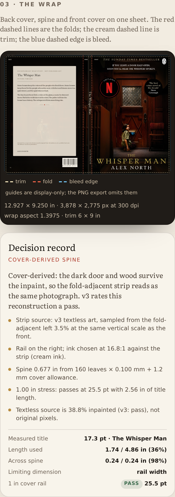
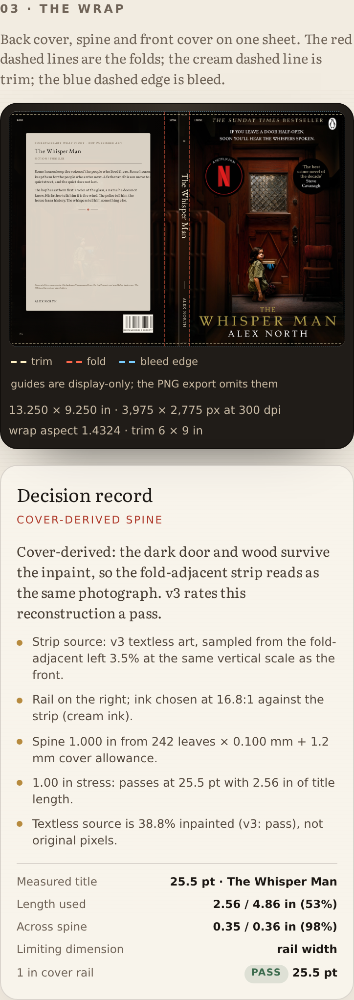
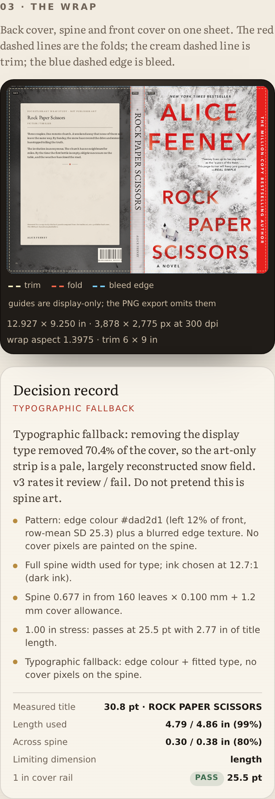
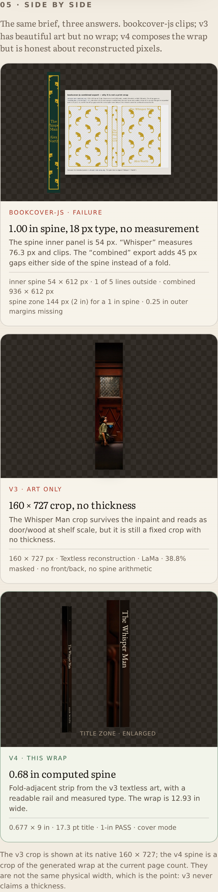
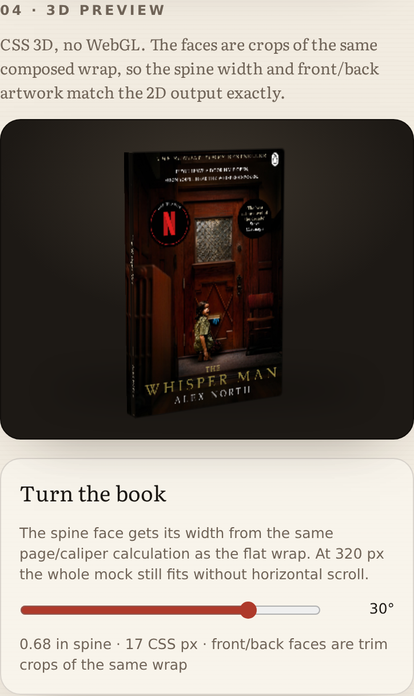

# v4 — an in-house continuous wrap compositor

**Status:** throwaway design/technical prototype, not production code. Everything
lives under `.scratch/spine-cover-art-prototype/v4-wrap/`. No production code,
existing prototypes, tests, manifests or specs were modified. Nothing was
committed or released.

**View:** <http://127.0.0.1:4173/spine-cover-art-prototype/v4-wrap/>  
(the `.scratch` folder is served by the existing static host on `0.0.0.0:4173`)

**Short verdict:** the technical path works. A page/caliper-derived continuous
back + spine + front wrap is practical with a single canvas, and a measured
type fit prevents the bookcover-js clipping failure at a 1-inch spine. The two
honest weak points are source resolution (300 dpi upscales the supplied covers)
and the back cover, which is generated rather than publisher art. *Rock Paper
Scissors* should use the typographic fallback, not its 70.4%-inpainted strip.



---

## What this tests

The earlier test showed that **bookcover-js cannot do this job**: it accepts SVG
line art rather than a raster cover, its spine width is a manually entered inch
value with no page count, its fixed 18 px type clips at 1 inch, and its combined
export is three panels separated by 45 px gaps. The 3D comparables are either a
front-cover mock or a plain coloured spine box.

This prototype tests the actual path:

1. Take a **real front cover** for *The Whisper Man*, *Rock Paper Scissors* and
   *Moby-Dick*.
2. Compute the spine from **page count × paper caliper + cover allowance**.
3. Compose **back + spine + front** on one canvas, with trim, bleed and folds,
   with no gaps.
4. Draw one of two spines:
   - **cover-derived** — a real fold-adjacent vertical strip of the cover art
     (textless art where available, or the published cover) plus a readable rail;
   - **typographic fallback** — dominant cover-edge colour/pattern plus fitted
     title and author.
5. Fit the type with **real `canvas.measureText` metrics** and report the fit.
6. Preview in CSS 3D and export a 2D PNG at 300 dpi.
7. Compare the result with bookcover-js's failure and with the v3 art-only spine.

The page shows the spine width, wrap/print size, trim and bleed, page count,
paper caliper, title fit, limiting dimension, 1-inch stress result, edge-colour
measurement and every fallback decision.

---

## Computed dimensions for the samples

All samples: **6 × 9 in trim, 0.125 in bleed, cream 80 gsm at 0.100 mm per leaf,
1.2 mm cover allowance, 320 pages.**

| Sample | Mode | Spine | Wrap | 300 dpi print | Title fit |
|---|---|---:|---:|---:|---|
| *The Whisper Man* | cover-derived | **0.677 in / 17.2 mm** | **12.927 × 9.250 in** | **3,878 × 2,775 px** | 17.3 pt, 98% of rail, PASS |
| *Rock Paper Scissors* | typographic | 0.677 in / 17.2 mm | 12.927 × 9.250 in | 3,878 × 2,775 px | 30.8 pt, 99% of length, PASS |
| *Moby-Dick* | cover-derived | 0.677 in / 17.2 mm | 12.927 × 9.250 in | 3,878 × 2,775 px | 17.3 pt, 98% of rail, PASS |

The spine is 160 leaves × 0.100 mm + 1.2 mm cover = **17.2 mm**. Front and back
trim panels are 1,800 × 2,700 px at 300 dpi; the spine is 203 px wide; the bleed
is 37.5 px per edge.

### 1-inch stress

`Set a 1.00 in spine` solves the page count for the current caliper:

| Target | Pages | Actual spine | 300 dpi print | Cover-rail type |
|---|---:|---:|---:|---|
| 1.000 in | 484 | **1.000 in / 25.4 mm** | **3,975 × 2,775 px** | 25.5 pt, PASS |

The fit test always runs at **exactly 1.000 in**, independent of the current
page count, for all three books. Across-spine measured glyph box: 106 px of the
108 px rail (0.353 in of 0.360 in); the longest title length is 2.77 in of the
4.86 in allowed. **No clipping.**



### Thin-spine fallback

At the minimum 48 pages the arithmetic gives 3.6 mm, clamped to a 0.20 in fold
minimum. The cover rail can no longer hold the title at 7 pt, so the compositor
switches to the typographic fallback rather than clipping. It fits at 11.0 pt
across the full 0.20 in spine. This is recorded in `audit.json` and in the UI.

---

## How the path works

### Geometry

```
spine      = (pages / 2) × caliper_mm + 1.2 mm cover allowance
wrap width = 2 × trim width + spine + 2 × bleed
wrap height= trim height + 2 × bleed
```

Positions are one continuous fold map, in inches:

```
0 ─ bleed ─ back trim ─ FOLD ─ spine ─ FOLD ─ front trim ─ bleed
```

The canvas draws the back panel, then the front, then the spine last with a 1 px
overlap at each fold. `layout.backFold === layout.spineX` and
`layout.spineX + spine === layout.frontFold` are asserted in the capture audit.
The on-screen canvas and the export use the same renderer; only the pixels per
inch differ.

### Spine modes

**Cover-derived.** The source is a vertical strip from the published cover or
the v3 textless art. The strip is cropped at the fold-adjacent left edge and
scaled so the vertical scale matches the front. A 46%-wide rail carries the
title and author. Rail ink is cream or dark based on the measured luminance of
the strip; the current contrast is reported (16.8:1 for *The Whisper Man*).
The RPS default is **typographic**, because the v3 removal audit rates the
textless reconstruction review/fail; forcing cover-derived on RPS is allowed but
shows the warning.

**Typographic fallback.** The background is the mean left-12% edge colour (for
RPS: `#dad2d1`, row-mean SD 25.3), with the edge strip blurred over it at low
opacity and a faint rule pattern. No cover pixels are painted on the spine.
Type uses the full spine width and fitted title/author.

### Type fit

The compositor measures the actual font:

- `canvas.measureText(text)` at 100 px gives advance width and the real
  `actualBoundingBoxAscent + Descent`;
- the maximum point size is the smaller of the across-spine limit (rail width
  minus padding) and the along-spine length limit;
- the chosen size is re-measured and shrunk in 1.5% steps until the real metrics
  are inside the box, because advance is not perfectly linear with size;
- if it cannot reach 7 pt, it switches mode or reports a clip risk. It never
  silently clips.

The font is **EB Garamond** (SIL OFL), loaded as a `FontFace` and awaited before
any layout. The 3D/compare faces use the same composed wrap, so the fit is
identical in all views.

### Back cover

The back is generated. It mirrors the textless art so its fold edge meets the
spine, darkens it, and places a vellum card with the title, an original
prototype blurb, author and a placeholder barcode. The card is watermarked with
very low-opacity art so it does not read as an empty rectangle. **This is not a
publisher back cover and the blurb is not publisher copy.**

### 3D and export

- **3D:** CSS `preserve-3d` with front, back, spine and page-block faces. No
  WebGL. The rotate slider moves the book ±55°; the spine face gets its CSS
  width from the same calculated spine. At 320 px the stage still fits.
- **Export:** `Download 2D wrap PNG` renders a fresh canvas at 300 dpi with no
  guides and downloads it. The captured sample is **3,878 × 2,775 px**, 9.39 MB,
  fully opaque (minimum alpha 255). File name includes book, page count, spine
  width, mode and DPI.



---

## Side by side



| | bookcover-js | v3 art-only | v4 wrap |
|---|---|---|---|
| Input | SVG line art | pre-cropped 160 × 727 art | real front cover + art |
| Spine width | manual inch | fixed crop | page/caliper arithmetic |
| 1 in type | **clips** (`Whisper` 76.3 px in 54 px) | n/a | **fits** at 25.5 pt |
| Front/back | independent panels | none | continuous wrap |
| Folds | 45 px gaps | n/a | exact shared fold lines |
| Print | cut/plot SVG | none | 300 dpi RGB PNG |
| 3D | none | shelf mock only | CSS 3D book |

The bookcover-js comparison image and numbers come from the earlier isolated
test in `../bookcover-js-test/`: 54 px inner spine, 76.3 px “Whisper”, one of
five lines outside the panel, 45 px gaps, 936 × 612 px combined output. They
were not rerun for this prototype. The v3 crop is shown at its native 160 × 727;
the v4 spine is a crop of the generated wrap at the current page count. They are
deliberately not the same physical width: v3 never claims a thickness.



---

## Run, reproduce, capture

The static server was already running. To serve `.scratch` yourself:

```bash
cd /mnt/ssd2/Projects/PocketLibrary
python3 -m http.server 4173 --bind 0.0.0.0 --directory .scratch
```

Open:

```text
http://127.0.0.1:4173/spine-cover-art-prototype/v4-wrap/
```

Capture screenshots and write the audit (Playwright is resolved from the repo
root `node_modules`, like the other prototypes):

```bash
cd /mnt/ssd2/Projects/PocketLibrary
node .scratch/spine-cover-art-prototype/v4-wrap/capture.cjs
```

Outputs:

- `screenshots/01-full-390.png` — full page at 390 px (780 × 12,652)
- `screenshots/02-hero-390.png` — hero at 390 px
- `screenshots/03-wrap-whisper-{390,360,320}.png` — the wrap at each width
- `screenshots/04-compare-{390,360,320}.png` — side-by-side at each width
- `screenshots/05-3d-{390,360,320}.png` — 3D preview at each width
- `screenshots/06-rps-typographic-390.png`
- `screenshots/07-rps-typographic-320.png`
- `screenshots/08-moby-cover-390.png`
- `screenshots/09-stress-1in-390.png`
- `screenshots/10-stress-1in-320.png`
- `screenshots/17-export-whisper-320pp-300dpi.png` — the actual downloaded PNG
- `audit.json` — metrics, overflow, fold pixels, console/request results

### Test results

| Check | 390 px | 360 px | 320 px |
|---|---|---|---|
| Horizontal overflow | 0 px | 0 px | 0 px |
| All images loaded | yes | yes | yes |
| Fold continuity (both folds) | yes | yes | yes |
| Transparent pixels in fold columns | 0 | 0 | 0 |
| Near-white (gap-looking) fold pixels | 0 | 0 | 0 |
| Page errors / console errors | 0 / 0 | 0 / 0 | 0 / 0 |
| Failed requests | 0 | 0 | 0 |
| Fonts loaded | yes | yes | yes |

The fold check reads the actual on-screen canvas columns at the two fold x
positions. The export was separately checked for full opacity (alpha 255
everywhere) and the PNG header is 3,878 × 2,775.

The page exposes a small test API:

```js
window.PocketWrap.ready
window.PocketWrap.getState()
window.PocketWrap.setState({ pages: 484, mode: "cover" })
window.PocketWrap.getMetrics()
window.PocketWrap.stressOneInch()
window.PocketWrap.exportPNG()
```

---

## Honest limitations

This is a prototype, not a print pipeline.

1. **The back cover is generated.** The blurb, barcode and layout are original
   prototype content, not publisher art. The barcode is deliberately scannable-
   looking but not a real retail barcode.
2. **The front covers are upscaled at 300 dpi.** The modern covers are
   1,303 × 2,000 px; the front panel plus its bleed is about 1,838 × 2,775 px,
   so the export upsamples about 1.4× linearly (2× area). The classic art is
   1,042 × 1,563 and worse. This is a source-resolution limit, not a compositor
   limit; production would need higher-resolution or vector cover assets.
3. **The strip is not pixel-continuous with the published front.** For modern
   books the default strip comes from the v3 textless art, whose crop and scale
   differ from the published cover. It is the same artwork, not the same pixels.
   Choosing “Published front cover” makes source continuity exact but brings the
   printed cover text back into the strip.
4. **A generated spine is not a publisher spine.** Real spines are separately
   typeset and often differ from the front art. This tool composes a design from
   the front cover; it does not recover the printed spine.
5. **Paper figures are representative, not mill-certified.** 0.100 mm, 0.081 mm
   etc. are typical trade values. The fixed 1.2 mm cover allowance is an
   approximation. Real spine width needs the printer's measured caliper/PPI and
   cover-board thickness.
6. **No print production features.** RGB PNG only: no CMYK, ICC profile, PDF/X,
   crop marks, fold compensation, cover-board thickness, spine creep, hinge or
   gutter allowance, dust-jacket flaps, or barcode verification.
7. **Typography is one face.** EB Garamond only, no condensed/small-caps
   variant, no hyphenation. If a title still cannot fit at 7 pt in the
   typographic full-width mode, the UI reports a clip risk rather than hiding
   it. Nothing in the sample set reaches that state.
8. **The 3D preview is an approximation.** CSS 3D, not a page-simulation or
   WebGL renderer. It shows front/back/spine/page-block faces, but no board
   thickness, rounded spine, head/tail bands or page curvature. It is not
   exportable.
9. **Edge colour is a JPEG-dependent 128 px sample.** No colour management; it
   is a design heuristic, not a measured printed ink.
10. **Only 390 / 360 / 320 px were tested.** No 375/414 px, landscape, zoom,
    Safari/Firefox, or screen-reader pass beyond basic labels/roles.
11. **RPS is the failure case, left visible.** The textless art is 70.4%
    inpainted and reads as pale snow; the default is the typographic fallback.
    Forcing cover-derived shows the warning, not a clean result.
12. **The bookcover-js numbers are reused, not rerun.** They come from
    `../bookcover-js-test/REPORT.md` and its captures, which are included here
    for comparison.
13. **Asset rights.** The modern covers and their textless derivatives are
    publisher/designer artwork used only as design reference in this throwaway
    prototype; they are not public domain and imply no production licence. The
    classic painting is public domain. Back-cover copy is written for this
    prototype.

---

## Files

```
.scratch/spine-cover-art-prototype/v4-wrap/
  index.html                 single page + CSS, UI and 3D scene
  src/
    books.js                 three sample books + original prototype blurbs
    geometry.js              paper stocks, spine arithmetic, wrap fold map
    compose.js               colour sampling, measured fit, canvas compositor
    app.js                   state, controls, stats, 3D, export, test API
  assets/                    copied v3 covers/art/crops + bookcover-js captures
  fonts/                     EB Garamond and Literata (SIL OFL) + OFL texts
  screenshots/               390/360/320 captures, 3D, compare, export PNG
  capture.cjs                Playwright screenshots + audit
  audit.json                 machine-readable results
  README.md                  this file
```

### Asset provenance

- `assets/whisper-man-cover.jpg`, `rock-paper-scissors-cover.jpg`,
  `assets/moby-dick.jpg` — copied from `../v3/assets/`.
- `assets/*-art.jpg` — copied from `../v3/art/` (textless art; the two modern
  files are LaMa reconstructions, the classic is a public-domain painting).
- `assets/*-spine.jpg` — copied from `../v3/crops/` (160 × 727 art-only crops).
- `assets/bookcover-js/` — copied from `../bookcover-js-test/captures/`.
- `fonts/*.woff2` and OFL texts — copied from `../v3/`.

The front cover proportions differ slightly from the 6 × 9 trim, so the
published cover is cover-cropped (never stretched) into the front panel.

**Deliberately not done:** no production code, tests, manifests or specs were
changed; no commits, tags or releases. The v3 and bookcover-js prototypes are
intact. This is **front-cover artwork composed into a wrap**, not a scan of a
printed spine.
