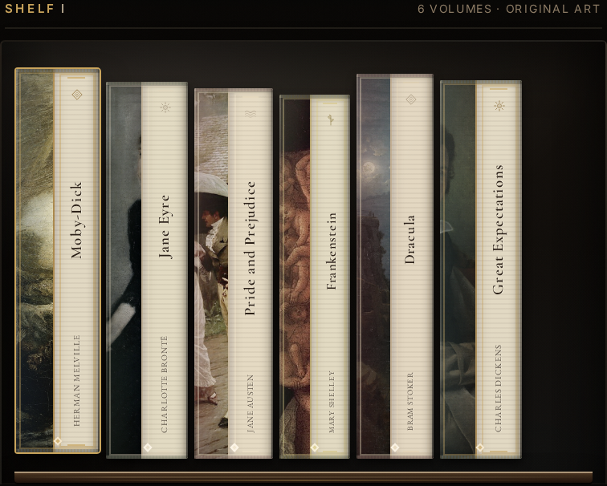
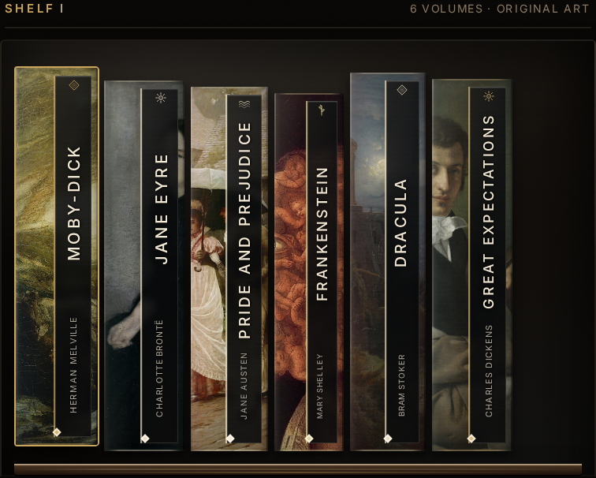
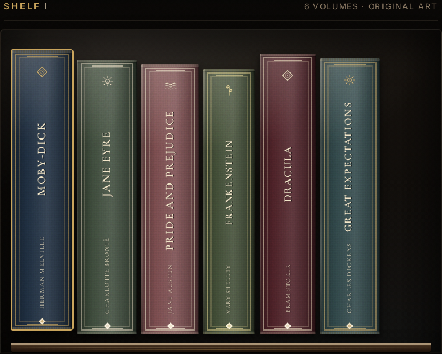
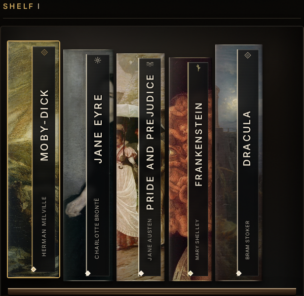
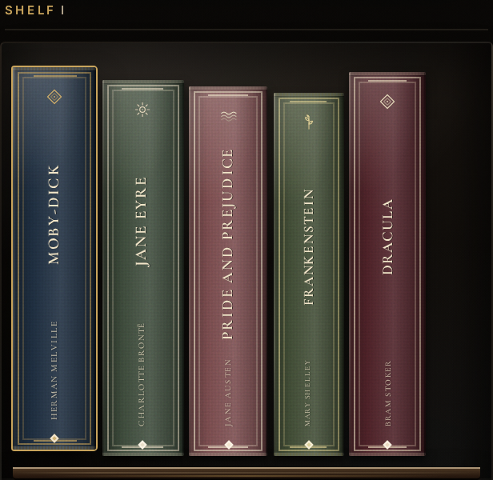
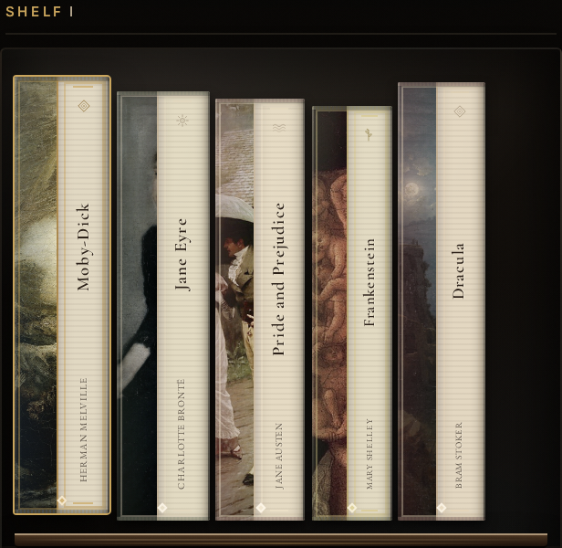

# v6 — the spine at forty-eight pixels

**Status:** throwaway design prototype, not production code. Everything lives in
`.scratch/spine-cover-art-prototype/v6/`. No production code, tests, manifests,
other prototypes or specs were modified. Nothing was committed or
released.

**View:** <http://127.0.0.1:4173/spine-cover-art-prototype/v6/>  
(served by the existing static host on `0.0.0.0:4173`)

**The recommendation in one line:** make **Hybrid** the production default
(art window + paper label), keep **Editorial** as the art-first mode, and use
**Clothbound** for a public-domain classics shelf. The full rationale and
build plan is in
[`../BEAUTIFUL-SPINE-PLAN.md`](../BEAUTIFUL-SPINE-PLAN.md).



---

## Why Hybrid wins

| Measured at 390 / 360 / 320 | Editorial | Clothbound | Hybrid |
|---|---:|---:|---:|
| Smallest title | 7.45 px | 7.50 px | **7.70 px** |
| Ink used by the tightest title | 96.5% | 96.2% | **91.4%** |
| Titles below 4.5:1 | 0 | 0 | **0** |
| Clipped title / author | 0 | 0 | **0** |
| Real artwork on the spine | yes (strip) | no (colour only) | **yes (window)** |
| Reads at 40 px, no rail | yes | yes | yes |

Hybrid is the only direction that keeps a genuine art window and a
high-contrast label at the same time. Its 7.7 px minimum is the largest of the
three; its 91.4% ink use leaves the most breathing room; and its dark ink on
warm paper is the most stable contrast pair across all 21 books. Clothbound is
the more beautiful object in isolation, and Editorial is the cleanest modern
treatment, but both trade away either the art or the type margin.

**Production defaults proposed:**

1. **Hybrid** — default for a mixed modern/classics library.
2. **Editorial** — an “art first” alternate for browsing, and for covers whose
   art is the point.
3. **Clothbound** — a series mode for public-domain classics, where a
   publisher-style cloth colour and foil type read as a set.

---

## The three directions

All three share one shelf, one DOM tree, one measured type engine and the same
21 books. The direction changes the composition, not the data.

### 01 · Modern editorial — full bleed + smoked rail



- Full-bleed vertical slice of the real textless / reconstructed art.
- A 44.5%-wide smoked-glass rail on the right, 5 px inset top and bottom, with
  a 0.5 px inner hairline and a one-pixel accent edge.
- Title in Inter 500 caps at 0.17em tracking; author in Inter 400 caps at the
  foot; 1 px accent rules at head and tail; a 4 px lozenge for provenance.
- Animation: none on the spine. Hover lifts 3 px; selection lifts 4 px and
  adds a 1 px accent ring.

At 46 px the art strip is about 26 px wide. It is enough for a face, a horizon
or a colour field; it is not enough for a full cover. That is the trade.

### 02 · Clothbound — cloth field + foil type



- No raster art. The book’s measured palette is distilled into a curated cloth
  colour; a radial key light, a woven grain and an edge shadow do the work.
- Double rule frame inset 3 px, 11 px ornament at the head, 2 px head/tail
  bands, foil/emboss title in Cormorant Garamond 600 caps at 0.11em tracking.
- Author at the foot in matching Cormorant caps.
- When a title cannot fit in one line at ≥6.9 px, it is set on **two balanced
  lines** across the spine. This is what keeps *The Hound of the Baskervilles*
  at 8.9 px on a 46.6 px spine instead of shrinking it to 5.5 px.

This is the strongest “beautiful book” direction. It is also the most honest
about the limits of a 40 px spine: it stops pretending to show the cover.

### 03 · Hybrid — art window + paper label


- A 43.5% vertical art window on the left; a 56.5% warm paper label on the
  right. The art is duotoned toward the cloth colour (`saturate .62`,
  `brightness .92`) so it belongs to the paper.
- The paper carries a laid-paper texture, a 0.5 px gold boundary, a 2 px outer
  frame and a 0.5 px inner rule. Title in Cormorant Garamond 600 title case at
  0.055em; author in EB Garamond at the foot.
- Headband, ornament, edge wear and vignette follow the same material logic as
  Clothbound, but the art does the identity work.

This reads as a half-bound book: a real picture on the boards, a printed label
on the spine. It is the most legible at phone width and the most recognisable
as the *cover* rather than a generated colour.

### The same shelf at 320 px

| Editorial | Clothbound | Hybrid |
|---|---|---|
|  |  |  |

At 390 and 360 px the shelf packs 6/5/5/5; at 320 px it packs 5/5/6/5; a wide shelf packs 11/10. No text is clipped and no horizontal scrollbar appears. A 40 px spine keeps a 7.45–7.70 px title.

---

## The design system

### Art treatment

| Treatment | Where | What survives at 40 px |
|---|---|---|
| Full-bleed art | Editorial | A vertical slice; focal point chosen from the art’s `focus[0]` |
| Art window | Hybrid | A 18–23 px window; duotoned into the cloth palette |
| Colour-wash | Both art directions | A 12–34% cloth tint / vignette, not a filter stack |
| Paper strip | Hybrid | A 23–31 px warm label with a measured ink contrast |
| Cloth | Clothbound | A curated colour field with weave, edge and foil |

The source slice is never a squashed thumbnail. `background-size: cover` on a
2:3 source crops horizontally; the horizontal position is calculated from the
book’s focus point and the actual window width, so the same painting has a
defensible crop on every spine width.

### Typography

| Role | Family / weight | Size | Tracking | Case |
|---|---|---|---:|---|
| Editorial title | Inter 500 | 8.2–10.2 px | 0.17em | upper |
| Editorial author | Inter 400 | 4.2–5.5 px | 0.12em | upper |
| Cloth title | Cormorant Garamond 600 | 7.6–9.7 px | 0.11em | upper |
| Cloth author | Cormorant Garamond 500 | 4.2–5.6 px | 0.13em | upper |
| Hybrid title | Cormorant Garamond 600 | 7.7–9.5 px | 0.055em | title |
| Hybrid author | EB Garamond 400 | 4.2–5.3 px | 0.08em | upper |
| Page reading | Literata 400 | 11–15 px | 0 | sentence |

Titles are rotated −90° so they read bottom-to-top (UK/US shelf convention).
The author is a separate measured block at the foot, not a second line of the
title. Long titles fall back to two balanced lines before they are allowed to
drop below 6.9 px; three lines are never attempted because they do not survive
40 px. This is the most important typographic rule in the study.

### Material cues

| Cue | Implementation | Off switch |
|---|---|---|
| Cloth grain | 1 px warp/weft + SVG turbulence, `overlay` | Material off |
| Paper fibre | 1 px laid lines, 0.026 alpha, multiply | Material off |
| Foil | Cream/gold ink, 0.5 px highlight + 0.5 px emboss shadow | Material off |
| Emboss | Title shadow: dark below, light above | Material off |
| Head/tail bands | 2 px woven accent/paper/cloth stripes, 52% opacity | Material off |
| Edge wear | Inset 1 px cream left edge, dark right edge | Always |
| Contact shadow | Blurred radial under each book on the shelf | Always |
| Vignette | Inset 0 3 px 6 px dark + cream edge | Always |
| Shelf light | Gallery / Lamp / Dusk CSS variables | Lighting control |

The `Material: cues on/off` switch exists so the shelf can be reviewed without
the noise: with cues off, the same hierarchy must still hold. It does.

### Provenance without clutter

Every shelf spine carries a **4 px lozenge at the tail**:

- **Original art** — filled accent lozenge.
- **Reconstructed** — half-filled lozenge (a split, not a badge).
- **Typographic fallback** — hollow lozenge.

The word “ORIGINAL ART” / “RECONSTRUCTED” never appears on the shelf. It lives
in the selected-spine card, where the route, page count, measured fit, contrast
and palette can be read in full. The provenance filter isolates one class at a
time so the blend test is a deliberate act, not a guess.

### Light, dark and contrast fallbacks

- The textile field is dark by design; the page is a dark gallery and the
  spines are the light source.
- Every text/field pair is **measured**, not assumed. Editorial uses a fixed
  cream on a smoked rail composited over the art’s measured average; Clothbound
  picks cream or ink brown by comparing WCAG contrast; Hybrid uses dark ink on
  paper. The detail card reports the ratio (e.g. 11.1:1 for Hybrid
  *Moby-Dick*). The audit reports zero pairs below 4.5:1.
- If an art file fails, the spine keeps its cloth field, rail/paper and fitted
  type. The `.is-artless` class is applied after preload, so the shelf never
  shows a blank hole.
- `prefers-reduced-motion` removes transitions; `forced-colors` supplies a
  CanvasText outline and removes decorative shadows.

---

## Measured type fitting

The fit runs in `canvas.measureText` at 100 px, after `document.fonts.ready`,
for every title and author. It uses the real `actualBoundingBoxAscent` /
`Descent` (ink height) and the advance width plus the CSS tracking.

For each direction and each book:

```
thickness    = rail / paper / cloth width minus padding
titleLength  = spine length minus head/tail insets minus measured author block
maxSize      = min(aesthetic cap, thickness × 0.965 / inkRatio,
                   titleLength × 0.965 / advanceRatio)
```

The chosen size is then reduced in 0.025 px steps until both the ink box and
the advance are inside the available box. It is never rounded up. A 3.5%
safety margin absorbs the difference between canvas metrics and the browser’s
rotated ink box.

If a one-line fit falls below 6.9 px, the engine tries every word boundary and
picks the split with the smallest longer line. Two lines are used only when
they produce a **>8%** larger size and the rail is at least 12 px thick. The
renderer then places two block lines inside the same title element; the
thickness test becomes `2 × lineHeight × size`.

The **Ink used** value in the detail card is `max(fitLength, fitThickness)`.
The **limiting** reason is one of `length`, `thickness`, `aesthetic cap` or
`two-line cap`, so a 43% figure cannot be misread as a near-clip.

### Fit audit (from `audit.json`)

| Width | Direction | Shelf packing | Smallest title | Tightest ink use | Clips | Low contrast |
|---:|---|---|---:|---:|---:|---:|
| 390 | Editorial | 6/5/5/5 | 7.45 px | 96.5% | 0 | 0 |
| 390 | Clothbound | 6/5/5/5 | 7.50 px | 96.2% | 0 | 0 |
| 390 | Hybrid | 6/5/5/5 | 7.70 px | 91.4% | 0 | 0 |
| 360 | Editorial | 6/5/5/5 | 7.45 px | 96.5% | 0 | 0 |
| 360 | Clothbound | 6/5/5/5 | 7.50 px | 96.2% | 0 | 0 |
| 360 | Hybrid | 6/5/5/5 | 7.70 px | 91.4% | 0 | 0 |
| 320 | Editorial | 5/5/6/5 | 7.45 px | 96.5% | 0 | 0 |
| 320 | Clothbound | 5/5/6/5 | 7.50 px | 96.2% | 0 | 0 |
| 320 | Hybrid | 5/5/6/5 | 7.70 px | 91.4% | 0 | 0 |

The clipped-title test compares each rotated title/author `getBoundingClientRect`
against its spine rect with a 0.8 px tolerance. It is a DOM test, not a
trust-the-metrics test. It found 0 clipped elements at every width and
direction.

---

## Controls

- **Direction** — Editorial / Clothbound / Hybrid. The shelf, detail card and
  fit line update together.
- **Title rail** — On/Off. Off hides type and the Editorial smoked rail. The
  typographic fallback keeps its type in every mode, because type is the whole
  treatment.
- **Lighting** — Gallery / Lamp / Dusk. Changes the shelf key light, fill and
  shadows; the spine sheen follows.
- **Material** — cues on/off. Removes grain, paper fibre, headbands, foil rules
  and emboss; the composition and measured type stay identical.
- **Provenance** — All / Original / Recon / Fallback. Re-packs the same shelf
  with only that class. Counts are live.
- **Select a spine** — opens the detail card with the 1.55× preview, route,
  page/caliper model, shelf width, type size, ink use, limiting reason,
  contrast, palette and “Copy tokens”.
- **Actual size** — toggles the detail preview to 1× (the real 40–55 px spine).
- **Test API** — `window.PocketV6.ready`, `.getState()`, `.setDirection()`,
  `.setRail()`, `.setLight()`, `.setMaterial()`, `.setFilter()`,
  `.selectBook(id)`, `.getMetrics()`, `.getAudit()`.

The fallback book keeps its own fitted type when the rail is off. It never
pretends to have art: its art window is the measured edge colour, not cover
pixels.

---

## Test results

Fresh Chromium captures, 2× DPR, 390 / 360 / 320 px.

| Check | 390 | 360 | 320 |
|---|---|---|---|
| Horizontal page overflow | **0 px** | **0 px** | **0 px** |
| Spine title/author clips | **0** | **0** | **0** |
| Console errors | **0** | **0** | **0** |
| Page errors | **0** | **0** | **0** |
| Failed requests | **0** | **0** | **0** |
| Fonts loaded | 4/4 | 4/4 | 4/4 |
| UI text overflow (console/detail/buttons) | **0** | **0** | **0** |
| Titles under 4.5:1 | **0** | **0** | **0** |
| Filter: reconstructed | 1 shelf / 2 spines | — | — |
| Filter: fallback | 1 shelf / 1 spine | — | — |

The test also covers rail-off, material-off, lamp, dusk, the fallback detail
and the actual-size preview. All passes are in [`audit.json`](audit.json)
(29 screenshots, 10 measured passes, 0 errors).

---

## What to borrow from bookcover-js — and what not to

The full audit is in
[`../bookcover-js-deep/harness/HANDS-ON.md`](../bookcover-js-deep/harness/HANDS-ON.md).

**Genuinely reusable (as design/logic, not code):**

1. **Spine-only export** is a real path. Upstream saves the inner spine SVG at
   72 px/in with no front/back panels. That contract — one spine, transparent
   background, padding only for plotters — is the right one. v6’s geometry and
   export plan keep it.
2. **The frame system**: outer rectangle + thin inner rule, inset from the
   spine edge. It is the visual signature of the Penguin-style spine and it
   survives at 40 px.
3. **The typographic style catalogue**: style 1 (stacked words), style 2
   (rotated title + author), style 3 (centred rotated title with tracking).
   v6 keeps the *ideas* and adds measured fit.
4. **Transparent SVG + 10× PNG** is a sensible export split. v6 would generate
   the SVG first and rasterise it, rather than screenshotting a DOM.
5. **Colour pairing**: a background field plus one ink colour. v6 replaces the
   single `elementColor` with a measured palette and a contrast check.

**Must be replaced for PocketLibrary:**

1. Raster input. Upstream accepts `.svg` only and parses it as line art. v6
   uses full-bleed raster art with a calculated crop.
2. Spine width. Upstream takes a manual inch value. v6 derives display width
   from the v4 page/caliper model: `(pages/2 × 0.100 mm) + 1.2 mm`, then a
   separate 40–55 px shelf zoom.
3. Type fit. Upstream has fixed px sizes and clips at normal spines. v6
   measures and shrinks, with a two-line fallback.
4. Full-bleed placement. Upstream tiles uploaded images as ornaments. v6 uses
   a single `cover` slice with a focus point.
5. PNG gutters. Upstream’s spine PNG includes transparent border gaps; v6’s
   shelf/export contract is an exact rectangle.
6. Continuous wrap. bookcover-js has no back/spine/front fold model. v4-wrap
   remains the place for that.

### MPL-2.0

bookcover-js is **MPL-2.0**, a file-level copyleft licence.

- Copying or modifying its source files means those files (and derivatives)
  stay MPL-2.0 and their source must be made available. The rest of the app can
  remain under another licence as a larger work if the MPL files stay
  separable.
- It is not GPL: it does not force the whole PocketLibrary codebase to MPL.
- If a future production build vendors a patched `penguinstyle.js`, keep the
  MPL header, include the licence, publish the modified source, and do not
  bury it in a proprietary minified bundle without the corresponding source.
- **v6 copies no bookcover-js code, SVG paths, or assets.** The ship ornament
  is not reused; v6 draws four original geometric marks. The ideas above are
  reimplemented. That keeps this prototype clean and leaves the production
  decision explicit.

This is an engineering summary, not legal advice.

---

## Files

```
.scratch/spine-cover-art-prototype/v6/
  index.html                  the page: masthead, console, shelves, detail, system
  styles.css                  tokens, shelf, three spine directions, material, responsive
  app.js                      geometry, measured fit, two-line fallback, renderer, test API
  data.js                     generated from tools/source-data.js + v6 pages/palette
  tools/build-data.mjs        rebuilds data.js (pages, curated palette, measured avg/dom)
  capture.cjs                 Playwright screenshots + audit
  audit.json                  metrics, clips, overflow, console, filters, fonts
  fonts/                      Inter, Cormorant Garamond (+italic), EB Garamond, Literata + OFL
  assets/classics/            18 × cover, art, spine crop (vendored)
  assets/modern/              Whisper Man + RPS art, cover, generated, rejected LaMa
  screenshots/                29 fresh 390/360/320 captures
```

Rebuild the data and captures:

```bash
cd /mnt/ssd2/Projects/PocketLibrary
node .scratch/spine-cover-art-prototype/v6/tools/build-data.mjs
node .scratch/spine-cover-art-prototype/v6/capture.cjs
```

Serve (if the existing host is not already up):

```bash
python3 -m http.server 4173 --bind 0.0.0.0 --directory .scratch
```

---

## Honest limitations

1. **The shelf is a design mock.** It is front-cover artwork and invented
   cloth fields on a spine, not a scan of a printed spine. There is no
   spine-art archive.
2. **The page/caliper numbers are edition-shaped.** Page counts are plausible,
   not fetched metadata. The 40–55 px width is a deliberate display zoom, not
   physical millimetres.
3. **The reconstructions are inventions.** *The Whisper Man* and *Rock Paper
   Scissors* are in copyright; their textless derivatives are design
   references only. The `RECONSTRUCTED` route and detail copy say so.
4. **The fallback is not a publisher spine.** *Rock Paper Scissors* fallback is
   a measured edge colour + fitted type, no cover pixels.
5. **Two lines is a heuristic.** It is only tried below 6.9 px and only when
   the rail is thick enough. A future production pass should allow title
   abbreviation and manual line-break overrides.
6. **Only 390 / 360 / 320 px were tested.** No 375/414, landscape, zoom,
   Safari/Firefox, or full screen-reader pass.
7. **Artwork licences are unchanged from the source dataset.** The 18 classics are public
   domain; the two modern covers are in copyright and used only as throwaway
   references.
8. **Fonts** are SIL OFL; the licence texts are included in `fonts/`.
9. **No export is wired in v6.** The production path should generate an SVG
   spine first (one rectangle, transparent background), then rasterise it at
   300 dpi; do not screenshot the DOM.
10. **Modern CSS.** `color-mix()` and `backdrop-filter` are used for the cloth
    mixes and smoked rail. Chromium, Safari and current Firefox support them;
    a production fallback should resolve the mixes to hex at build time.

---

## Licence

**Prototype:** throwaway design reference, not production code.

**Classics art:** public-domain paintings from Wikimedia Commons and
public-domain Standard Ebooks cover crops, as documented in `sources.json`.

**Modern covers:** *The Whisper Man* (Penguin UK, ISBN 9781405936019) and
*Rock Paper Scissors* (Flatiron US, ISBN 9781250266118) are in-copyright
edition covers used only in this prototype. No production use is implied.

**Fonts:** Inter, Cormorant Garamond, EB Garamond and Literata under the SIL
Open Font License; OFL texts are in `fonts/`.

**bookcover-js:** MPL-2.0; no code or assets are copied into v6. See
`../bookcover-js-deep/harness/HANDS-ON.md` and the plan for the licence
boundary.
