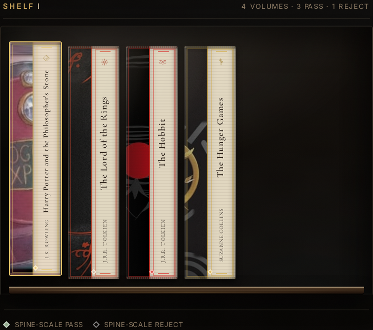
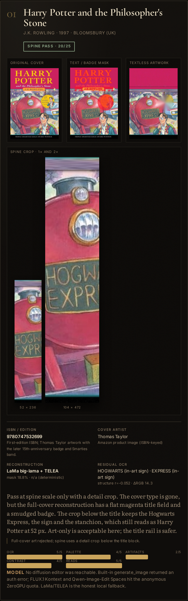
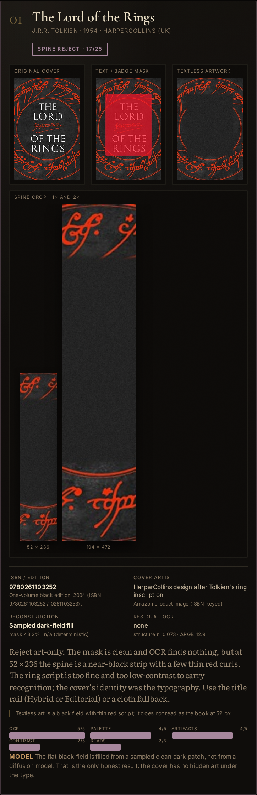
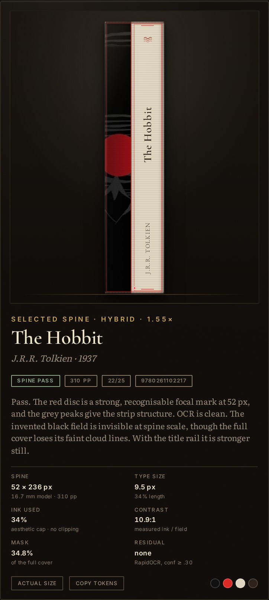

# v7 — popular covers at spine scale

**Status:** throwaway design prototype, not production code. Everything lives in
`.scratch/spine-cover-art-prototype/v7/`. No production app code, tests,
manifests or specs were modified. Nothing was committed or released.

**View:** <http://127.0.0.1:4173/spine-cover-art-prototype/v7/>  
(served by the existing static host on `0.0.0.0:4173`)

**The finding in one line:** popular commercial covers are viable at spine
scale only when a **single object** carries the identity. *The Hobbit*'s red
sun and *The Hunger Games*' gold pin survive; *The Lord of the Rings*' one-volume
cover is its typography, so the textless spine is an empty black strip. *Harry
Potter* survives only as a **detail crop** — the full-cover reconstruction does
not.



---

## Verdicts

| Book | Edition / ISBN | Cover artist | Spine verdict | Total |
|---|---|---|---|---:|
| *Harry Potter and the Philosopher's Stone* | Bloomsbury UK, 1997 first-edition ISBN **9780747532699**; the scan is a later printing with the 15th-anniversary badge and the Smarties band | **Thomas Taylor** | **Pass with a detail crop.** Full-cover art rejected. | 20/25 |
| *The Lord of the Rings* | HarperCollins UK one-volume black edition, 2004, **9780261103252** | HarperCollins design after Tolkien's ring inscription | **Reject art-only.** Use the title rail or type on cloth. | 17/25 |
| *The Hobbit* | HarperCollins UK black edition, 2009, **9780261102217** | HarperCollins design; mountain/sun motif after Tolkien (artist credit not stated on the edition record) | **Pass.** | 22/25 |
| *The Hunger Games* | Scholastic US first hardcover, 2008, **9780439023481** | **Tim O'Brien** | **Pass.** | 21/25 |

### *Harry Potter* — pass only as a crop



- The title block is a full-width painted-sky area. A large-mask LaMa pass smears
  it into a flat magenta field; TELEA propagation removes the letters but leaves
  a visibly invented title field.
- The 15th-anniversary badge sits over the train and characters. Removing it
  leaves a soft blur that is obvious at 2×.
- The **spine crop starts below the title block** and keeps the Hogwarts Express,
  the front lamp and the "HOGWARTS EXPRESS" sign. At 52 × 236 it reads
  immediately as *Harry Potter*.
- This is not a full-cover textless result. The card says so; the filter counts
  it as a spine-scale pass with a caveat.

### *The Lord of the Rings* — reject art-only



- The one-volume black cover is mostly title, signature and flat black. The ring
  inscription is thin red line work.
- The mask is clean; RapidOCR finds **no** residual text. The textless result is
  still a near-black strip with a few red curls at 52 px.
- The ring script is too fine and too low-contrast to identify the book. This is
  the clearest case where **the cover's identity is its typography**, and the
  honest answer is a typographic spine, not art.

### *The Hobbit* — pass



- The title and author sit on flat black. A sampled clean dark field removes both
  blocks with no visible seam.
- The red sun is a strong focal mark at 52 px, and the grey peaks give the strip
  vertical structure.
- The full cover loses its faint horizontal cloud lines where the title block
  was. At spine scale this is invisible; at full-cover scale it is a trade.

### *The Hunger Games* — pass

- The gold mockingjay pin and the grey target rings survive untouched.
- The title and author blocks are on flat near-black, so the fill is clean.
- The title block takes the top target ring with it. The pin still carries the
  identity, so this is acceptable at spine scale.

---

## Scores

Five criteria, 0–5 each. The score is a design judgment backed by the measured
numbers in the same row.

| Book | Residual OCR | Palette / structure | Artifacts | Spine contrast | Recognisability | Total |
|---|---:|---:|---:|---:|---:|---:|
| Harry Potter | 5 | 4 | 2 | 4 | 5 | **20** |
| The Lord of the Rings | 5 | 4 | 4 | 2 | 2 | **17** |
| The Hobbit | 5 | 5 | 4 | 4 | 4 | **22** |
| The Hunger Games | 5 | 4 | 4 | 4 | 4 | **21** |

Measured inputs from [`tools/recon-meta.json`](tools/recon-meta.json):

| Book | Source px | Mask | Residual OCR | Structure r | ΔRGB outside mask | Spine luma σ | Non-dark px |
|---|---|---:|---|---:|---:|---:|---:|
| Harry Potter | 420 × 621 | 18.8% | none for cover type; 2 in-art signs retained | −0.052 | 14.25 | 37.73 | 97.5% |
| The Lord of the Rings | 326 × 500 | 43.2% | none | 0.073 | 12.94 | 16.16 | 41.5% |
| The Hobbit | 308 × 500 | 34.8% | none | 0.006 | 10.63 | 23.25 | 20.9% |
| The Hunger Games | 330 × 500 | 43.5% | none | 0.004 | 7.22 | 39.50 | 24.1% |

The **Hogwarts Express** sign and the **9¾** platform sign are in-art lettering,
not cover typography. They are deliberately retained. RapidOCR still reads
"HOGWARTS" and "EXPRESS" on the HP textless file; that is the only residual OCR
in the set, and it is not a cover-title leak.

---

## What was actually used for reconstruction

The brief asked for the best available generative image-editing path. The
routes available in this environment were tried, and each failed:

| Route | Model | Result |
|---|---|---|
| Built-in `generate_image` | `openai/gpt-image-2.6-sunburst` | HTTP 401, incorrect API key |
| Built-in `generate_image` | `opencode/grok-imagine-image-2.0` | invalid credential |
| HF Space | `black-forest-labs/FLUX.1-Kontext-Dev` | anonymous ZeroGPU quota exhausted (105 s requested / 89 s left) |
| HF Space | `prithivMLmods/FireRed-Image-Edit-1.0-Fast` (Qwen-Image-Edit) | anonymous ZeroGPU quota exhausted (120 s requested / 29 s left) |
| Pollinations `kontext` | FLUX.1 Kontext | HTTP 403, requires a Pollinations API key |

The prototype therefore records the failure and uses the best **local** fallback:

1. **RapidOCR** finds printed text and gives boxes.
2. Hand-defined regions cover display type and marketing that OCR misses.
3. **LaMa big-lama** (simple-lama-inpainting, CPU) inpaints the masked areas.
4. **TELEA** propagates flat surrounding colour through large HP glyphs.
5. **Sampled dark-field fill** removes type from the flat-black covers.

No licensed textless file exists for any of these covers. Every pixel under the
removed type is invented or filled; the prototype says so per book.

**A stronger editor would likely improve Harry Potter and might recover a little
more of the Lord of the Rings ring glow. It would not give the Lord of the Rings
an object to recognise.** The results are a conservative lower bound, not a
ceiling for Kontext/Qwen-class editing.

---

## Spine-scale acceptance test

The product is the **52 × 236 px** spine, not the full cover. The page shows the
original, the mask, the textless art, and the spine at 1× and 2×.

- **Pass** means: no cover type survives OCR in the crop, the palette and focal
  object survive at 52 px, and the crop still reads as the book.
- **Reject** means: the reconstruction is clean but has too little structure at
  52 px, or a large masked area is visibly invented. Fall back to type.

The filter at the top of the page re-packs the same shelf and the case list:
**All 4 / Pass 3 / Rejected 1**.

---

## Measured type

The v6 measured type engine is reused unchanged. It runs in
`canvas.measureText` at 100 px after `document.fonts.ready`, uses real ink
ascent/descent, and shrinks in 0.025 px steps with a 3.5% safety margin.

At 390 / 360 / 320 px:

| Check | Result |
|---|---|
| Titles / authors clipped | **0** |
| Smallest title | **7.75 px** (*Harry Potter*, 96.4% of its paper label) |
| Other titles | 9.50 px, 34–64% of the label |
| Ink/field contrast | **10.9–11.1 : 1** (all above 4.5:1) |
| Two-line fallback needed | none at this width; the engine supports it |
| Horizontal page overflow | **0 px** |
| Visible clips with the rail off | **0** |
| Console / page / request errors | **0 / 0 / 0** |
| Images loaded | 20/20 at every width |
| Fonts | loaded |

The HP title is the tightest at **96.4% length**; the engine chose 7.75 px rather
than shrinking below the 6.9 px two-line threshold. It does not clip.

---

## Design

The v6 system is reused: Hybrid (art window + paper label) is the default,
Editorial (full bleed + smoked rail) is the alternate, and the **With title
rail / Art only** control proves what the art does without type.

- **Hybrid** is the safer default for commercial covers: the paper label
  guarantees a readable title, and the art window still carries the sun, pin or
  train. All four spines are legible at 320 px.
- **Editorial** is stronger for *Harry Potter* and *The Hobbit*, where the art is
  the point, and weak for *The Lord of the Rings*, where the rail is doing all the
  work.
- **Art only** is the honest test. It confirms the LOTR reject and shows that the
  other three still read as objects.

Material cues, lighting (Gallery / Lamp / Dusk), provenance lozenges and the
measured type are unchanged from v6.

---

## Screenshots

Fresh Chromium captures, 2× DPR, 390 / 360 / 320 px. The shared study dock is
hidden in captures so it does not cover the work.

| File | What |
|---|---|
| `00-hero-390.png` | masthead, facts and controls |
| `01-shelf-hybrid-390.png` | Hybrid shelf, all four |
| `02-case-harry-potter-390.png` | full pipeline + 1×/2× spine |
| `03-detail-hybrid-390.png` | selected HP detail, 1.55× |
| `04-shelf-rejected-390.png` | Rejected filter |
| `05-case-lotr-390.png` | LOTR case |
| `06-shelf-pass-390.png` | Pass filter |
| `07-shelf-editorial-390.png` | Editorial direction |
| `08-shelf-art-only-390.png` | Art only (no title rail) |
| `09-detail-lotr-390.png` | LOTR detail |
| `10-shelf-lamp-390.png` | Lamp lighting |
| `11-full-390.png` | full page at 390 |
| `12-detail-actual-390.png` | actual 52 × 236 spine |
| `13-system-390.png` | findings and recommendation |
| `14-detail-hobbit-390.png` | Hobbit detail |
| `20-shelf-hybrid-360.png` | shelf at 360 |
| `21-full-360.png` | full page at 360 |
| `20-shelf-hybrid-320.png` | shelf at 320 |
| `21-full-320.png` | full page at 320 |

All 19 captures are in [`screenshots/`](screenshots/). The audit is
[`audit.json`](audit.json).

---

## Failure modes, honestly

1. **Harry Potter's full-cover reconstruction is not usable.** The title field
   is a flat magenta invention and the badge removal is a blur. The spine passes
   only because the crop starts below the title. Do not present the full-cover
   file as a clean textless cover.
2. **The Lord of the Rings has nothing to reconstruct.** The cover's identity is
   the title, signature and flat black field. The textless result is clean and
   empty. This is a genuine reject, not a tuning problem.
3. **Flat-black fills erase real detail.** *The Hobbit* loses faint cloud lines;
   *The Hunger Games* loses the top target ring. Invisible at 52 px, visible at
   full-cover scale.
4. **Three sources are 500 px tall.** The 2× spine crop (472 px) is a downsample,
   not an upscale, for all four; Harry Potter is 621 px. The 1× crops are also
   downsampled from the source. There is no invented resolution, but there is
   no extra detail either.
5. **In-art lettering is retained.** The Hogwarts Express sign and 9¾ are part of
   the illustration. Removing them would destroy the train and hurt recognition.
   Residual OCR on HP is therefore expected and labelled.
6. **No diffusion editor was available.** The reconstruction is LaMa/TELEA/sampled
   fill, not FLUX/Qwen. The card-level notes and the table above record the exact
   failures. A future pass should rerun the same masks through a working Kontext
   or Qwen-Image-Edit endpoint and compare.
7. **Only 390 / 360 / 320 px were tested.** No 375/414, landscape, zoom,
   Safari/Firefox, or full screen-reader pass.
8. **Covers are in copyright.** They are used only as throwaway design
   references; nothing here implies production use. No production assets or code
   were touched.
9. **Fonts** are SIL OFL; licence texts are in `fonts/`.
10. **The page uses modern CSS** (`color-mix()`, `backdrop-filter`); a production
    build should resolve the mixes to hex.

---

## Files

```
.scratch/spine-cover-art-prototype/v7/
  index.html                  masthead, controls, shelf, pipeline cases, finding
  styles.css                  v6 tokens + shelf/spine CSS + v7 case/score CSS
  app.js                      measured type engine, shelf, cases, detail, test API
  data.js                     four books, ISBNs, provenance, scores, model notes
  capture.cjs                 Playwright captures + audit
  audit.json                  widths, clips, overflow, images, errors, filters
  tools/
    pipeline.py               first pass: OCR + rectangle masks + LaMa
    refine.py                 glyph-shaped mask experiment
    finalize.py               region-strategy experiment
    clean.py                  final generator: TELEA / sampled dark-field fill
    recon-meta.json           measured mask, OCR, structure and spine numbers
  assets/source/              four original covers
  assets/mask/                mask previews + binary masks
  assets/art/                 textless full covers + 2× versions
  assets/spine/               52 × 236 crops
  assets/retina/              104 × 472 crops
  screenshots/                19 fresh captures
  fonts/                      Inter, Cormorant Garamond, EB Garamond, Literata + OFL
```

Reproduce the final assets and captures:

```bash
cd /mnt/ssd2/Projects/PocketLibrary

# CPU inpainting environment used for this run (v3 venv with cv2, rapidocr,
# simple-lama-inpainting and torch):
/tmp/opencode/v3venv/bin/python \
  .scratch/spine-cover-art-prototype/v7/tools/clean.py

node .scratch/spine-cover-art-prototype/v7/capture.cjs
```

`pipeline.py`, `refine.py` and `finalize.py` are the failed/intermediate passes.
They are kept because they document why the final mask strategy changed. The
final files are produced by `clean.py`.

Serve (if the host is not already up):

```bash
python3 -m http.server 4173 --bind 0.0.0.0 --directory .scratch
```

---

## Study navigation

The v7 page includes the shared `/spine-cover-art-prototype/study-nav.js` dock.
At capture time the dock already lists the study as **Popular books**. The dock
sequence and the root study README are owned by the shared navigation pass; this
folder only supplies the page and its assets.

---

## Licence

**Prototype:** throwaway design reference, not production code.

**Covers:** in-copyright edition scans from Amazon product-image endpoints,
documented per book in `data.js`. Used only as throwaway design references.
No production use is implied.

**Fonts:** Inter, Cormorant Garamond, EB Garamond and Literata under the SIL Open
Font License; OFL texts are in `fonts/`.
