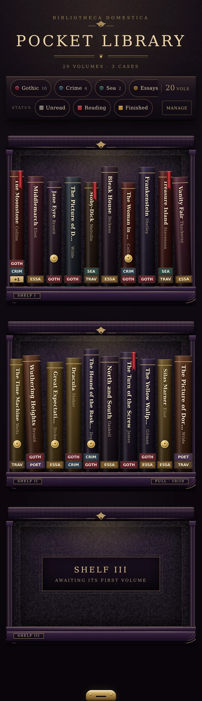
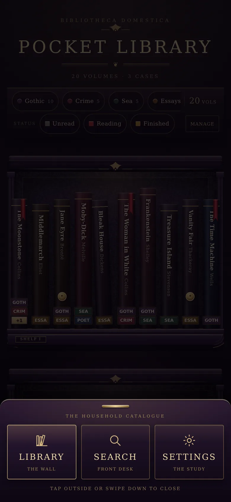
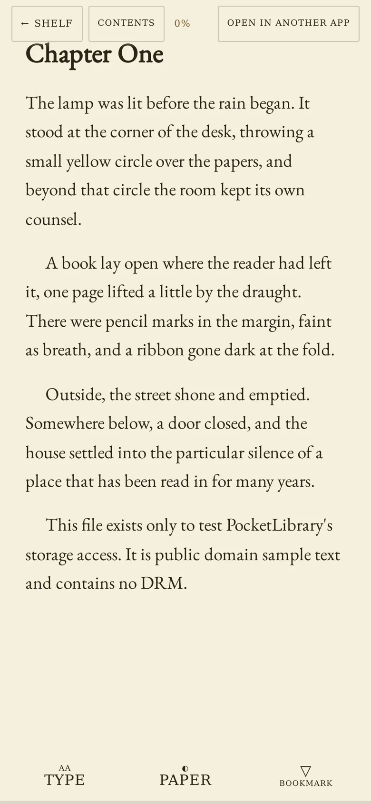

# PocketLibrary

[](https://github.com/YeahItsMeAgain/PocketLibrary/actions/workflows/ci.yml)

An Android-only reading room for the EPUBs and PDFs you already own. Point it at
a folder, arrange the books on manual shelves, and read them in place. No
account, sync service, store or telemetry.

**Version 0.1.2** · `app.pocketlibrary` · Android 8.0+ (API 24, arm64-v8a)

## Features

- **Library in place.** Scans a chosen folder, extracts EPUB/PDF covers and
  metadata, and never copies the books into app storage.
- **Manual shelves.** Fixed furniture, hand-placed books, reusable coloured
  labels and unread/reading/finished cues. Filters dim books without moving them.
- **Reader.** EPUB with highlights, notes, bookmarks and position resume; PDF
  with fit-width, pinch zoom, outline and page jump.
- **Acquisition.** Libgen search with a two-at-a-time download queue, progress,
  cancel, retry and mirror failover.
- **Backup.** Versioned metadata archive with merge-by-default restore and an
  explicit replace option.
- **Diagnostics.** Local rolling log and a one-tap share-sheet export.
- **Updates.** Signed APK updates from GitHub Releases, verified by SHA-256 and a
  version-bound minisign signature before Android's installer runs.

## Screenshots

<table>
  <tr>
    <td align="center" valign="top">
      
      <br><sub>The wall</sub>
    </td>
    <td align="center" valign="top">
      
      <br><sub>Book detail</sub>
    </td>
    <td align="center" valign="top">
      
      <br><sub>The drawer</sub>
    </td>
    <td align="center" valign="top">
      
      <br><sub>EPUB reader</sub>
    </td>
  </tr>
</table>

## Install

Download the signed APK from
[Releases](https://github.com/YeahItsMeAgain/PocketLibrary/releases/latest) and
sideload it:

```bash
adb install -r PocketLibrary-0.1.2.apk
```

The release is signed with `CN=PocketLibrary`. Installing over an earlier release
with the same key keeps the database, folder grant and settings. On first launch,
choose a normal subfolder such as `Documents/PocketLibrary`; Android will not
grant the storage root or `Download`.

APK SHA-256:
`837f8224797a8a64653f3230a6b977b85074fd5ee77ca280efe8a93ae47cf061`.

## Development

Prerequisites and signing are in [`docs/build.md`](docs/build.md).

```bash
npm ci
cargo test --manifest-path core/Cargo.toml
npx tsc --noEmit
npm run build
npm run test:e2e

source scripts/android-env.sh
npm run tauri android build -- --apk --target aarch64 --ci
```

CI runs the core tests, type check, web build and Playwright suite. The Android
APK is built locally because it needs the SDK, NDK and release keystore.

## Architecture

- **Tauri 2 + Rust shell** (`src-tauri/`) owns Android integration, thin
  commands and the WebView; **React 19 + Vite** (`src/`) renders the UI.
- **Headless Rust core** (`core/`) holds SQLite, scanning, metadata, covers,
  backup, downloads, diagnostics and update verification. It is testable without
  Tauri.
- **One platform seam.** `src/platform.ts` is the only native boundary and is
  mocked for Playwright.
- **Readers.** [foliate-js](src/vendor/foliate/) for EPUB, PDF.js for PDF.
- **Storage.** Books stay in the user-granted folder through the Android Storage
  Access Framework; BLAKE3 hashes identify them across rescans.

## Documentation

- [Release notes](docs/release-0.1.2.md) · [Diagnostics](docs/diagnostics.md) ·
  [Updates and signing](docs/updates.md) · [Build guide](docs/build.md)
- [Performance benchmark](docs/perf-shelf-benchmark.md) ·
  [Architecture decisions](docs/adr/) · [Contributing](CONTRIBUTING.md)
- [Third-party notices](THIRD_PARTY_NOTICES.md)

## Licence

MIT — see [`LICENSE`](LICENSE).
